# 2do Parcial INT201 – Machine Learning (02-2026) · Guía de revisión docente

Banco de **50 preguntas** basadas en escenarios de **ciberseguridad / TI**. Cada pregunta tiene la misma estructura:

1. **Contexto**: describe el escenario e incluye un recuadro **«Recuerda»**, una pista de lectura con la definición
   o fórmula necesaria. El estudiante que lee con atención tiene la herramienta, pero **igual debe interpretar los
   datos o el gráfico** para responder.
2. **Datos de muestra**: tabla con filas del escenario.
3. **Gráfico**: generado a partir de los mismos datos, para que sean coherentes.
4. **Hipótesis**: una afirmación que el estudiante debe **validar o refutar** con la evidencia.
5. **Pregunta**: de selección única, selección múltiple, verdadero/falso, respuesta corta, arrastrar y soltar,
   emparejamiento o completar (cloze).

## Archivos

| Archivo | Uso |
|---|---|
| `parcial2_INT201_50preguntas.xml` | Importar en Moodle (las imágenes van embebidas) |
| `guia_revision_parcial2.md` | Esta guía: preguntas, respuestas, pistas y explicaciones |
| `img/qNN.png` | Gráficos (solo para esta guía; el XML no los necesita) |
| `generar_banco.py`, `motor.py`, `preguntas_*.py` | Generador: edita una pregunta y vuelve a ejecutar `python generar_banco.py` |

## Cómo importar en Moodle

1. **Banco de preguntas → Importar → Formato «Moodle XML»**, subir `parcial2_INT201_50preguntas.xml`.
2. Se crean 3 subcategorías bajo **`02-2026 INT201 - P2 Machine Learning`**: `1 - Fácil`, `2 - Intermedio`, `3 - Difícil`.
3. Todas las preguntas llevan las etiquetas **`02-2026 INT201`** y **`P2`**, además del nivel (`Facil`,
   `Intermedio`, `Dificil`) y una etiqueta de tema (por ejemplo `kNN`, `Data leakage`). Las etiquetas van
   **sin tildes** a propósito: Moodle ya tiene `Facil`/`Dificil` y una versión con tilde provoca
   «Error escribiendo a la base de datos».
5. Si un import falla, prueba primero `prueba_importacion_7tipos.xml` (una pregunta de cada tipo, en una
   categoría aparte) para identificar qué tipo causa el problema.
4. Para armar el examen se puede usar **«Añadir pregunta aleatoria»** por subcategoría (ej. 8 fáciles + 8
   intermedias + 4 difíciles) o filtrar por etiqueta.

## Puntajes y penalizaciones

| Nivel | Puntaje por pregunta (`defaultgrade`) |
|---|---|
| Fácil | 1 |
| Intermedio | 2 |
| Difícil | 3 |

- Las 24 preguntas de selección única y múltiple muestran al estudiante un **aviso rojo**: las respuestas
  incorrectas restan puntos y, si no está seguro, conviene dejarla en blanco.
- **Selección única**: cada opción incorrecta resta (−33.3 % con 4 opciones).
- **Selección múltiple**: cada correcta suma por igual; cada incorrecta resta (−33.3 % o −50 %). El mínimo de la
  pregunta es 0.
- **Verdadero/Falso**: sin penalización negativa (penalty = 1 solo aplica en modo interactivo).
- **Cloze (completar)**: Moodle calcula el puntaje con los **pesos de cada hueco** (`{1:...}`, `{2:...}`), no con
  `defaultgrade`. Si quieres que valgan 2 o 3 puntos, ajusta la **nota máxima** en el cuestionario.
- Puntaje total sin cloze: **75** puntos (7 preguntas cloze adicionales).

## Distribución

**Por nivel:** Fácil: 20, Intermedio: 18, Difícil: 12

**Por tipo:** Selección única: 21, Verdadero / Falso: 7, Respuesta corta: 5, Arrastrar y soltar: 4, Emparejamiento: 3, Completar: 7, Selección múltiple (varias correctas): 3

| Código | Nivel | Tipo | Tema | Título |
|---|---|---|---|---|
| Q01 | Fácil | Selección única | Tipos de problema supervisado | ¿Clasificación o regresión? Correos de phishing |
| Q02 | Fácil | Verdadero / Falso | Regresión lineal | Pendiente de la regresión lineal del Wi-Fi |
| Q03 | Fácil | Respuesta corta | Matriz de confusión | Nombre del error: malware que se deja pasar |
| Q04 | Fácil | Selección única | División entrenamiento / prueba | ¿Cuántos registros van a prueba? |
| Q05 | Fácil | Verdadero / Falso | Limpieza de datos (nulos) | ¿Eliminar todas las filas con nulos? |
| Q06 | Fácil | Selección única | Valores atípicos (outliers) | Valor atípico en datos subidos (DLP) |
| Q07 | Fácil | Arrastrar y soltar | Random Forest con scikit-learn | Entrenar y predecir con Random Forest |
| Q08 | Fácil | Selección única | k-Nearest Neighbors | k-NN con k = 3: votación de vecinos |
| Q09 | Fácil | Verdadero / Falso | Escalado de variables | k-NN sin escalar: ¿pesan igual las variables? |
| Q10 | Fácil | Respuesta corta | Codificación de variables categóricas | One-Hot Encoding de la columna protocolo |
| Q11 | Fácil | Selección única | Regresión logística | Sigmoide y umbral: ¿cuáles son phishing? |
| Q12 | Fácil | Selección única | Métricas: exactitud | Exactitud del filtro de spam |
| Q13 | Fácil | Verdadero / Falso | Sobreajuste y subajuste | Detector de bots: ¿sobreajuste? |
| Q14 | Fácil | Emparejamiento | Conceptos básicos de ML | Roles de las columnas en el dataset de USB |
| Q15 | Fácil | Selección única | Árboles de decisión | Leer un árbol de decisión de logins |
| Q16 | Fácil | Respuesta corta | Random Forest | El modelo que vota con muchos árboles |
| Q17 | Fácil | Verdadero / Falso | Correlación vs causalidad | Café y alertas: ¿correlación o causa? |
| Q18 | Fácil | Selección única | Clases desbalanceadas | El modelo «perezoso» con 99 % de exactitud |
| Q19 | Fácil | Arrastrar y soltar | Preprocesamiento (imputación, codificación, escalado) | Código de preprocesamiento para k-NN |
| Q20 | Fácil | Selección única | Regresión lineal | Predecir incidentes con regresión lineal |
| Q21 | Intermedio | Completar | Precisión, recall y exactitud | Métricas del IDS desde la matriz de confusión |
| Q22 | Intermedio | Selección única | Precisión vs recall | Ransomware: ¿precisión o recall? |
| Q23 | Intermedio | Selección única | k-NN y sobreajuste | Elegir el mejor k para k-NN |
| Q24 | Intermedio | Completar | k-NN: distancia euclidiana | Distancia euclidiana y votación en k-NN |
| Q25 | Intermedio | Respuesta corta | Escalado: estandarización | Valor z (StandardScaler) de un pico de logins |
| Q26 | Intermedio | Emparejamiento | Sobreajuste y subajuste | Diagnóstico: subajuste, sobreajuste o buen ajuste |
| Q27 | Intermedio | Completar | Naive Bayes / Teorema de Bayes | Naive Bayes: la palabra «urgente» |
| Q28 | Intermedio | Verdadero / Falso | Naive Bayes: supuestos | Supuesto de independencia de Naive Bayes |
| Q29 | Intermedio | Selección única | Validación cruzada | Validación cruzada inestable |
| Q30 | Intermedio | Arrastrar y soltar | Pipelines y validación cruzada | Pipeline: escalado + k-NN con validación cruzada |
| Q31 | Intermedio | Selección única | Umbral de decisión | Elegir el umbral según la política del SOC |
| Q32 | Intermedio | Selección única | Random Forest: importancia de variables | Interpretar la importancia de variables |
| Q33 | Intermedio | Respuesta corta | Fuga de información (data leakage) | ¿Cómo se llama el problema del 99.8 %? |
| Q34 | Intermedio | Selección única | Imputación de valores nulos | Imputar nulos: ¿media o mediana? |
| Q35 | Intermedio | Selección única | Regresión: métricas de error | Error absoluto medio (MAE) del modelo de VPN |
| Q36 | Intermedio | Verdadero / Falso | Escalado y tipo de modelo | ¿El escalado mejora a todos los modelos? |
| Q37 | Intermedio | Selección múltiple (varias correctas) | Selección de variables | Seleccionar variables irrelevantes |
| Q38 | Intermedio | Completar | Regresión lineal: predicción y residuo | Regresión lineal: restaurar un respaldo |
| Q39 | Difícil | Selección única | Regresión lineal vs logística | Regresión lineal para clasificar ataques |
| Q40 | Difícil | Completar | Costo de errores y matriz de confusión | Elegir modelo por costo, no por exactitud |
| Q41 | Difícil | Selección múltiple (varias correctas) | Fuga de información en el preprocesamiento | Escalar antes de dividir: ¿resultado confiable? |
| Q42 | Difícil | Selección única | Naive Bayes: supuestos y transformaciones | Gaussian Naive Bayes y la transformación logarítmica |
| Q43 | Difícil | Emparejamiento | Comparación de clasificadores | Elegir el clasificador según la necesidad del equipo |
| Q44 | Difícil | Completar | Teorema de Bayes y tasa base | IDS: ¿qué tan confiable es una alarma? |
| Q45 | Difícil | Selección única | Curvas de aprendizaje y subajuste | Curva de aprendizaje: ¿más datos? |
| Q46 | Difícil | Arrastrar y soltar | Umbral, predict_proba y métricas | Cambiar el umbral y medir el recall |
| Q47 | Difícil | Selección única | k-NN: fronteras de decisión | Fronteras de decisión de k-NN: k = 1 vs k = 25 |
| Q48 | Difícil | Completar | Validación cruzada | Una división con suerte vs validación cruzada |
| Q49 | Difícil | Selección múltiple (varias correctas) | Árboles vs Random Forest | Árbol único vs Random Forest |
| Q50 | Difícil | Selección única | División estratificada y clases raras | Recall 100 % con solo 2 ataques en prueba |

## Lista de verificación para revisar

- [ ] ¿La pista del recuadro «Recuerda» ayuda **sin dar** la respuesta directa? (ver «Pista incluida» en cada pregunta)
- [ ] ¿Los números de la tabla, el gráfico y la explicación coinciden?
- [ ] ¿Los distractores son plausibles (errores típicos de los estudiantes) y no ambiguos?
- [ ] ¿El nivel asignado corresponde a lo que vieron en clase?
- [ ] Respuesta corta: ¿faltan variantes aceptables? (agregar en `respuestas=[...]`)
- [ ] Cloze: los estudiantes deben usar **punto decimal**; el aviso está en cada pregunta.
- [ ] Después de importar, **previsualizar 2–3 preguntas de cada tipo** en Moodle (imágenes y arrastrar y soltar).

## Notas técnicas (reglas del generador de quizzes)

- Todo el contenido de `<text>` y `<feedback>` va en `CDATA`.
- Arrastrar y soltar (`ddwtos`): el `<dragbox>` N es **siempre** la respuesta de `[[N]]`, con el mismo grupo; los
  distractores van **al final**. El generador valida esto y que ninguna opción tenga `<` o `>`.
- Cloze: cada `MULTICHOICE` tiene exactamente una opción con `=` y sin `#`, `:` ni `{`.
- No se usa LaTeX (las fórmulas están en texto plano), así que no hay problemas de renderizado.

---

# Preguntas y respuestas

### Q01. ¿Clasificación o regresión? Correos de phishing

**Nivel:** Fácil · **Tipo:** Selección única · **Tema:** Tipos de problema supervisado · **Puntaje:** 1

**1. Contexto**

El Centro de Operaciones de Seguridad (SOC) de la universidad revisó 800 correos y a cada uno le puso una **etiqueta**: *phishing* o *legítimo*. Ahora quieren un modelo que, cuando llegue un correo nuevo, diga **a cuál de los dos grupos** pertenece.

**Recuerda:** si lo que queremos predecir es una *categoría* (un grupo, una clase) el problema es de **clasificación**; si es una *cantidad numérica continua* (precio, tiempo, GB) es de **regresión**. Lo que decide es la columna que se predice, no las columnas de entrada.

**2. Datos de muestra**

| correo_id | num_enlaces | remitente_externo | palabras_urgentes | etiqueta (y) |
|---|---|---|---|---|
| M-001 | 7 | sí | 3 | phishing |
| M-002 | 1 | no | 0 | legítimo |
| M-003 | 4 | sí | 2 | phishing |
| M-004 | 0 | no | 1 | legítimo |
| M-005 | 2 | sí | 0 | legítimo |

**3. Gráfico**

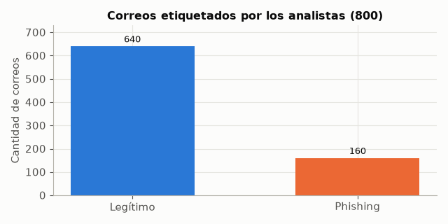

**4. Hipótesis**

> Como casi todas las columnas de entrada son números (enlaces, palabras urgentes), este es un problema de regresión.

**5. Pregunta**

¿Qué tipo de problema es y por qué?

**Respuesta**

- ✅ Clasificación, porque la variable que se predice (etiqueta) es una categoría: phishing o legítimo.
- ❌ Regresión, porque las variables de entrada son numéricas.
- ❌ Regresión, porque hay 800 correos y eso es una cantidad.
- ❌ Ninguno: no se puede usar Machine Learning cuando hay columnas de texto como «sí/no».

**Pista incluida en el contexto (para el docente):** El recuadro «Recuerda» indica que lo que define el tipo de problema es la columna que se predice.

**Explicación:** La hipótesis es falsa. La columna objetivo `etiqueta` toma solo dos valores (phishing / legítimo), así que es **clasificación binaria**. Que las entradas sean numéricas no cambia el tipo de problema.

---

### Q02. Pendiente de la regresión lineal del Wi-Fi

**Nivel:** Fácil · **Tipo:** Verdadero / Falso · **Tema:** Regresión lineal · **Puntaje:** 1

**1. Contexto**

El área de redes registró durante una semana cuántos usuarios se conectaron al Wi-Fi del campus y el tráfico total del día. Ajustaron una regresión lineal:

`trafico_GB = 5 + 0.8 × usuarios`

**Recuerda:** en `y = b + m·x`, la **pendiente** `m` dice cuánto cambia `y` cuando `x` aumenta en **1**. Aquí, cada usuario adicional suma 0.8 GB.

**2. Datos de muestra**

| día | usuarios | tráfico real (GB) |
|---|---|---|
| Lun | 50 | 44 |
| Mar | 80 | 70 |
| Mié | 120 | 101 |
| Jue | 150 | 126 |
| Vie | 200 | 163 |

**3. Gráfico**

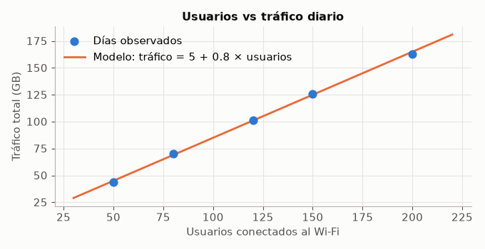

**4. Hipótesis**

> Según el modelo, si se conectan 100 usuarios más, el tráfico aumentará aproximadamente 80 GB.

**5. Pregunta**

¿La hipótesis es verdadera o falsa?

**Respuesta**

- **VERDADERO**

**Pista incluida en el contexto (para el docente):** El recuadro explica que la pendiente 0.8 es el aumento por cada usuario; basta multiplicar por 100.

**Explicación:** **Verdadero.** La pendiente es 0.8 GB por usuario: 100 × 0.8 = 80 GB. El gráfico muestra la recta subiendo de forma constante (relación positiva).

---

### Q03. Nombre del error: malware que se deja pasar

**Nivel:** Fácil · **Tipo:** Respuesta corta · **Tema:** Matriz de confusión · **Puntaje:** 1

**1. Contexto**

Un antivirus basado en Machine Learning analizó 500 archivos. Para el modelo, **«positivo»** significa *«este archivo es malware»* y **«negativo»** significa *«este archivo está limpio»*.

**Recuerda:** el nombre de cada celda tiene dos partes: **Verdadero/Falso** (¿el modelo acertó?) + **Positivo/Negativo** (¿qué *dijo* el modelo?).

**2. Datos de muestra**

| archivo | tamaño (KB) | ejecutable | predicción | real |
|---|---|---|---|---|
| factura.pdf | 210 | no | Limpio | Limpio |
| setup_crack.exe | 1840 | sí | Malware | Malware |
| foto_viaje.jpg | 3100 | no | Limpio | Limpio |
| invoice.exe | 96 | sí | Limpio | Malware |
| update.bat | 4 | sí | Malware | Limpio |

**3. Gráfico**

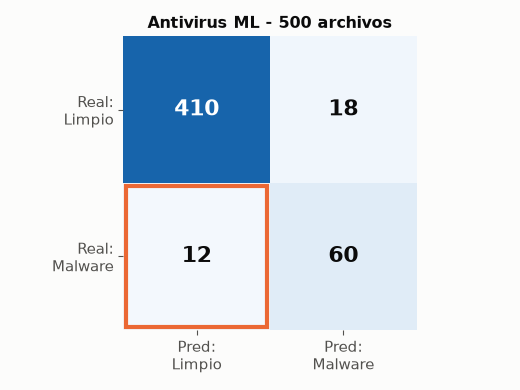

**4. Hipótesis**

> Los 12 archivos marcados en naranja son los errores más peligrosos, porque son malware real que llegó al usuario.

**5. Pregunta**

Los 12 archivos del recuadro naranja eran **malware real**, pero el modelo dijo **«Limpio»** (por ejemplo, `invoice.exe`). ¿Cómo se llama este tipo de error? *(Escribe dos palabras.)*

**Respuesta**

- Respuestas aceptadas (sin distinguir mayúsculas): `falso negativo`, `falsos negativos`, `false negative`, `false negatives`, `FN`

**Pista incluida en el contexto (para el docente):** El recuadro explica que el nombre se forma con ¿acertó? (no → Falso) + ¿qué dijo? (Limpio → Negativo).

**Explicación:** **Falso negativo (FN)**: el modelo dijo «negativo» (limpio) y se equivocó. En ciberseguridad es el error más peligroso, porque el malware entra sin alerta. El caso contrario (`update.bat`: limpio marcado como malware) es un falso positivo.

---

### Q04. ¿Cuántos registros van a prueba?

**Nivel:** Fácil · **Tipo:** Selección única · **Tema:** División entrenamiento / prueba · **Puntaje:** 1

**1. Contexto**

Un analista tiene **1 000 registros** de conexiones de red, cada uno etiquetado como *normal* o *ataque*. Antes de entrenar ejecuta:

```python
X_train, X_test, y_train, y_test = train_test_split(X, y, test_size=0.2, random_state=42)
```
**Recuerda:** `test_size` es la *proporción* (no la cantidad) de filas que se guardan para **evaluar** el modelo con datos que nunca vio durante el entrenamiento.

**2. Datos de muestra**

| ip_origen | puerto_destino | paquetes | duración (s) | etiqueta |
|---|---|---|---|---|
| 10.0.0.15 | 443 | 120 | 3.2 | normal |
| 185.22.4.9 | 22 | 950 | 0.4 | ataque |
| 10.0.0.31 | 80 | 64 | 1.1 | normal |
| 45.13.8.200 | 3389 | 1200 | 0.2 | ataque |

**3. Gráfico**

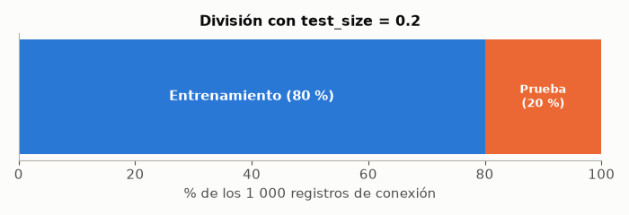

**4. Hipótesis**

> Con `test_size=0.2` solo se usan 20 registros para evaluar el modelo.

**5. Pregunta**

¿Cuántos registros quedan en el conjunto de prueba y para qué se usan?

**Respuesta**

- ✅ 200 registros; sirven para evaluar el modelo con datos que no vio al entrenar.
- ❌ 800 registros; sirven para entrenar el modelo.
- ❌ 200 registros; sirven para volver a entrenar el modelo y subir su exactitud.
- ❌ 20 registros; el número 0.2 indica 20 filas.

**Pista incluida en el contexto (para el docente):** El recuadro aclara que test_size es una proporción: 0.2 × 1 000.

**Explicación:** 0.2 × 1 000 = **200** registros de prueba (y 800 de entrenamiento). La prueba se usa *solo para evaluar*; si se entrenara con ella, ya no mediría el desempeño con datos nuevos.

---

### Q05. ¿Eliminar todas las filas con nulos?

**Nivel:** Fácil · **Tipo:** Verdadero / Falso · **Tema:** Limpieza de datos (nulos) · **Puntaje:** 1

**1. Contexto**

El registro de inicios de sesión del sistema académico tiene **2 000 filas**. La columna `pais_origen` se obtiene por geolocalización de la IP, que a veces falla y deja la celda vacía (NaN). El analista piensa usar `df.dropna()`.

**Recuerda:** `dropna()` elimina **toda la fila** si tiene al menos un valor nulo en *cualquier* columna.

**2. Datos de muestra**

| usuario | hora_login | pais_origen | dispositivo | login_exitoso |
|---|---|---|---|---|
| jperez | 08:12 | Bolivia | PC | 1 |
| mrojas | 23:47 | *NaN* | Móvil | 0 |
| acruz | 10:05 | Bolivia | PC | 1 |
| lquispe | 02:31 | *NaN* | *NaN* | 0 |

**3. Gráfico**

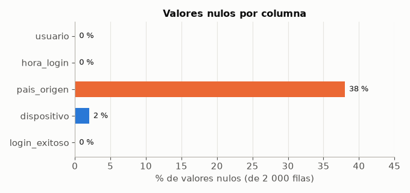

**4. Hipótesis**

> Aplicar `dropna()` a todo el dataset es buena idea porque solo se perderán unas pocas filas.

**5. Pregunta**

Observa el gráfico. ¿La hipótesis es verdadera o falsa?

**Respuesta**

- **FALSO**

**Pista incluida en el contexto (para el docente):** El gráfico muestra 38 % de nulos en pais_origen y el recuadro dice que dropna borra la fila completa.

**Explicación:** **Falso.** Al menos el 38 % de las filas (≈ 760 de 2 000) tiene `pais_origen` nulo, así que `dropna()` borraría más de un tercio del dataset, incluyendo información valiosa de las demás columnas. Es mejor imputar (por ejemplo con la categoría «Desconocido») o eliminar solo esa columna si no aporta.

---

### Q06. Valor atípico en datos subidos (DLP)

**Nivel:** Fácil · **Tipo:** Selección única · **Tema:** Valores atípicos (outliers) · **Puntaje:** 1

**1. Contexto**

El sistema de prevención de fuga de datos (DLP) mide cuántos MB sube cada empleado a internet por día. Normalmente los empleados suben entre 50 y 400 MB (correos, nube, videollamadas).

**Recuerda:** un **valor atípico (outlier)** es un dato muy alejado del resto. Puede ser un error de registro o algo real e importante; por eso primero se *investiga*.

**2. Datos de muestra**

| empleado | área | MB_subidos |
|---|---|---|
| E01 | Contabilidad | 120 |
| E02 | RRHH | 85 |
| E03 | Sistemas | 340 |
| E04 | Ventas | 9 800 |
| E05 | Legal | 210 |
| E06 | Soporte | 260 |

**3. Gráfico**

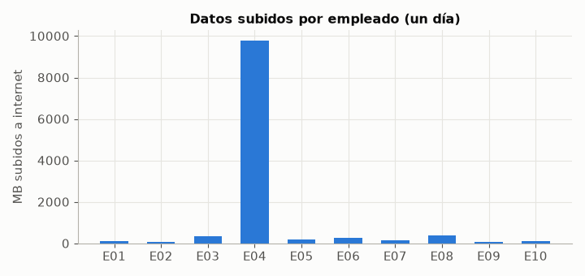

**4. Hipótesis**

> Todos los empleados tienen un comportamiento de subida de datos parecido.

**5. Pregunta**

¿Qué empleado presenta un valor atípico y cuál es la acción más razonable?

**Respuesta**

- ✅ E04: sube cerca de 25 veces más que los demás; hay que investigar si es una fuga de información o un error de registro antes de usar o descartar el dato.
- ❌ E03: porque es del área de Sistemas y ellos siempre son sospechosos.
- ❌ E02: porque tiene el valor más bajo de la tabla.
- ❌ Ninguno: todos están dentro de lo normal, la hipótesis es verdadera.

**Pista incluida en el contexto (para el docente):** El recuadro da el rango normal (50–400 MB); solo un valor se sale muchísimo.

**Explicación:** La hipótesis es falsa: E04 sube 9 800 MB, muy lejos del rango normal (50–400). En seguridad un outlier puede ser justamente el evento que buscamos (exfiltración de datos); no se borra sin investigarlo.

---

### Q07. Entrenar y predecir con Random Forest

**Nivel:** Fácil · **Tipo:** Arrastrar y soltar · **Tema:** Random Forest con scikit-learn · **Puntaje:** 1

**1. Contexto**

Se construye un detector de intrusiones (IDS) con un **Random Forest** (bosque de árboles de decisión) para clasificar conexiones en *normal* o *ataque*. Los datos ya fueron divididos en `X_train, X_test, y_train, y_test`.

**Recuerda:** en scikit-learn: `fit` = **aprender/entrenar** con datos de entrenamiento; `predict` = **predecir** sobre datos nuevos. Los nombres de los clasificadores terminan en `Classifier`.

**2. Datos de muestra**

| paquetes | bytes | puertos_distintos | duración (s) | etiqueta |
|---|---|---|---|---|
| 120 | 54000 | 1 | 3.2 | normal |
| 950 | 61000 | 45 | 0.4 | ataque |
| 64 | 9800 | 1 | 1.1 | normal |

**3. Gráfico**

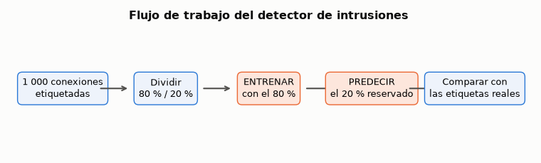

**4. Hipótesis**

> Para medir el desempeño real, el modelo debe predecir sobre los mismos datos con los que fue entrenado.

**5. Pregunta**

Arrastra las opciones para completar el código siguiendo el flujo del gráfico:

```python
from sklearn.ensemble import [[1→RandomForestClassifier]]

modelo = RandomForestClassifier(n_estimators=100, random_state=42)
modelo.[[2→fit]](X_train, y_train)
y_pred = modelo.[[3→predict]]([[4→X_test]])
```

**Respuesta**

- [[1]] → **RandomForestClassifier** (grupo 1)
- [[2]] → **fit** (grupo 2)
- [[3]] → **predict** (grupo 2)
- [[4]] → **X_test** (grupo 3)
- Distractores: `LinearRegression` (g1), `transform` (g2), `X_train` (g3), `y_test` (g3)

**Pista incluida en el contexto (para el docente):** El recuadro traduce fit = entrenar y predict = predecir; el gráfico dice que se predice el 20 % reservado.

**Explicación:** Se importa `RandomForestClassifier`, se entrena con `fit(X_train, y_train)` y se predice con `predict(X_test)`. La hipótesis es falsa: predecir sobre `X_train` daría un resultado optimista porque el modelo ya vio esos datos.

---

### Q08. k-NN con k = 3: votación de vecinos

**Nivel:** Fácil · **Tipo:** Selección única · **Tema:** k-Nearest Neighbors · **Puntaje:** 1

**1. Contexto**

Un sistema clasifica cada inicio de sesión como *normal* o *ataque* usando **k-NN con k = 3**. Llega un login nuevo (estrella amarilla). La tabla muestra sus 5 vecinos más cercanos ordenados por distancia.

**Recuerda:** k-NN toma **solo los k vecinos con menor distancia** y asigna la clase que más se repite entre ellos (votación). Los vecinos más lejanos no votan.

**2. Datos de muestra**

| vecino | distancia al nuevo | clase |
|---|---|---|
| A | 0.8 | ataque |
| B | 1.1 | ataque |
| C | 1.3 | normal |
| D | 2.0 | normal |
| E | 2.2 | normal |

**3. Gráfico**

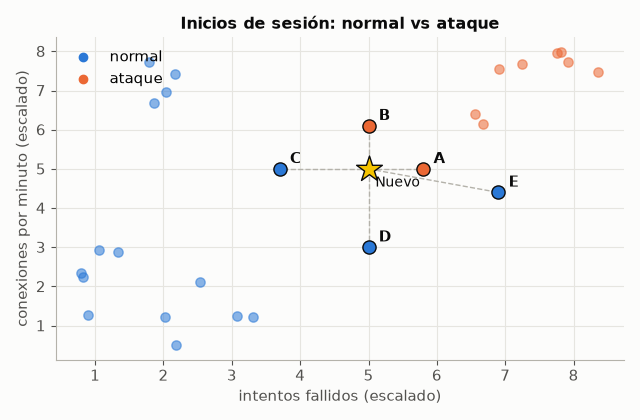

**4. Hipótesis**

> Como en la tabla hay más vecinos «normal» (3 de 5), el login nuevo será clasificado como normal.

**5. Pregunta**

Con **k = 3**, ¿cómo se clasifica el login nuevo?

**Respuesta**

- ✅ Ataque: de los 3 vecinos más cercanos (A, B, C), 2 son ataque.
- ❌ Normal: 3 de los 5 vecinos de la tabla son normal.
- ❌ Normal: el vecino más lejano (E) decide el desempate.
- ❌ No se puede decidir: hay un empate entre las clases.

**Pista incluida en el contexto (para el docente):** El recuadro dice que solo votan los k = 3 de menor distancia (las tres primeras filas).

**Explicación:** Los 3 más cercanos son A (ataque), B (ataque) y C (normal) → gana **ataque** 2 a 1. La hipótesis es falsa porque cuenta los 5 vecinos; con k = 5 sí ganaría normal. El valor de k cambia el resultado.

---

### Q09. k-NN sin escalar: ¿pesan igual las variables?

**Nivel:** Fácil · **Tipo:** Verdadero / Falso · **Tema:** Escalado de variables · **Puntaje:** 1

**1. Contexto**

Se quiere detectar equipos que hacen *escaneo de puertos* con k-NN usando dos variables: `bytes_enviados` (de 0 a 5 000 000) y `puertos_distintos` (de 0 a 20).

**Recuerda:** k-NN usa la **distancia euclidiana**: suma las diferencias al cuadrado de cada variable. Una diferencia de 1 000 bytes pesa muchísimo más que una diferencia de 15 puertos si no se escalan los datos.

**2. Datos de muestra**

| equipo | bytes_enviados | puertos_distintos | clase |
|---|---|---|---|
| PC-01 | 1 200 000 | 2 | normal |
| PC-02 | 1 201 000 | 18 | escaneo |
| PC-03 | 4 800 000 | 1 | normal |

**3. Gráfico**

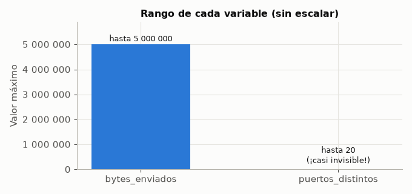

**4. Hipótesis**

> Sin escalar, ambas variables influyen por igual en la distancia que calcula k-NN.

**5. Pregunta**

Compara PC-01 y PC-02 en la tabla y observa el gráfico. ¿La hipótesis es verdadera o falsa?

**Respuesta**

- **FALSO**

**Pista incluida en el contexto (para el docente):** El recuadro explica que la diferencia de bytes (miles) domina sobre la de puertos (decenas).

**Explicación:** **Falso.** Entre PC-01 y PC-02 la diferencia de bytes es 1 000 → 1 000² = 1 000 000, mientras que la de puertos es 16 → 16² = 256. La distancia la decide casi solo `bytes_enviados`, aunque `puertos_distintos` es la que revela el escaneo. Por eso k-NN necesita `StandardScaler` o `MinMaxScaler`.

---

### Q10. One-Hot Encoding de la columna protocolo

**Nivel:** Fácil · **Tipo:** Respuesta corta · **Tema:** Codificación de variables categóricas · **Puntaje:** 1

**1. Contexto**

Un dataset de tráfico de red tiene la columna `protocolo`. Los modelos de scikit-learn necesitan números, así que hay que codificarla. Los protocolos **no tienen un orden** (TCP no es «mayor» que UDP).

**Recuerda:** **One-Hot Encoding** crea **una columna nueva de 0/1 por cada categoría distinta**. Ejemplo: colores {rojo, verde} → `color_rojo`, `color_verde`.

**2. Datos de muestra**

| conexion | protocolo | bytes | etiqueta |
|---|---|---|---|
| 1 | TCP | 5400 | normal |
| 2 | UDP | 300 | normal |
| 3 | ICMP | 64 | ataque |
| 4 | TCP | 120000 | ataque |

**3. Gráfico**

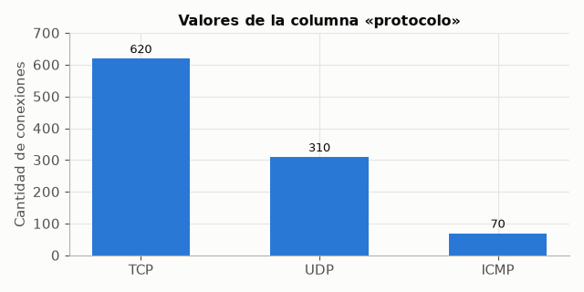

**4. Hipótesis**

> Basta con reemplazar TCP = 1, UDP = 2, ICMP = 3; así el modelo entenderá que ICMP es «mayor» que TCP.

**5. Pregunta**

La hipótesis es incorrecta porque inventa un orden. Si en su lugar aplicamos One-Hot Encoding (sin eliminar ninguna columna), **¿cuántas columnas nuevas se crean?** *(Escribe solo el número.)*

**Respuesta**

- Respuestas aceptadas (sin distinguir mayúsculas): `3`, `tres`

**Pista incluida en el contexto (para el docente):** El gráfico muestra cuántas categorías distintas hay; el recuadro dice una columna por categoría.

**Explicación:** Hay 3 categorías (TCP, UDP, ICMP) → **3 columnas**: `protocolo_TCP`, `protocolo_UDP`, `protocolo_ICMP`. Numerar 1, 2, 3 crea un orden falso que modelos como k-NN o la regresión logística interpretarían como distancias o magnitudes.

---

### Q11. Sigmoide y umbral: ¿cuáles son phishing?

**Nivel:** Fácil · **Tipo:** Selección única · **Tema:** Regresión logística · **Puntaje:** 1

**1. Contexto**

Un filtro de correo usa **regresión logística**. El modelo calcula un puntaje `z` y la **función sigmoide** lo convierte en una probabilidad entre 0 y 1.

**Recuerda:** la regla del filtro es: si `P(phishing) ≥ 0.5` → **phishing**; si es menor → legítimo. Observa que el signo es *mayor o igual*.

**2. Datos de muestra**

| correo | puntaje z | P(phishing) |
|---|---|---|
| C1 | -2.0 | 0.12 |
| C2 | 0.0 | 0.5 |
| C3 | 1.6 | 0.83 |
| C4 | -0.8 | 0.31 |

**3. Gráfico**

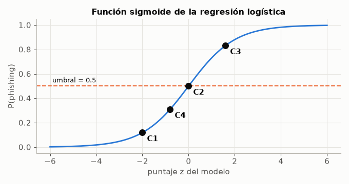

**4. Hipótesis**

> Solo el correo C3 será marcado como phishing.

**5. Pregunta**

Con umbral 0.5, ¿cuántos correos se marcan como phishing?

**Respuesta**

- ✅ 2 correos: C2 y C3, porque su probabilidad es mayor o igual a 0.5.
- ❌ 1 correo: solo C3, porque es el único con probabilidad alta.
- ❌ 3 correos: C2, C3 y C4, porque sus puntajes z son mayores que el de C1.
- ❌ Ninguno: para ser phishing la probabilidad debe ser mayor a 0.9.

**Pista incluida en el contexto (para el docente):** El recuadro destaca el «mayor o igual»; C2 está exactamente en 0.50.

**Explicación:** C2 (0.50) y C3 (0.83) cumplen `P ≥ 0.5` → 2 correos. La hipótesis es falsa porque olvida el caso límite. En la gráfica: z = 0 corresponde exactamente a P = 0.5.

---

### Q12. Exactitud del filtro de spam

**Nivel:** Fácil · **Tipo:** Selección única · **Tema:** Métricas: exactitud · **Puntaje:** 1

**1. Contexto**

Se evaluó un filtro de spam con **100 correos** que ya tenían etiqueta real. La matriz de confusión resume los resultados.

**Recuerda:** **exactitud (accuracy) = aciertos / total**. Los aciertos están en la **diagonal** de la matriz (arriba-izquierda y abajo-derecha).

**2. Datos de muestra**

| correo | asunto | predicción | real |
|---|---|---|---|
| #12 | Reunión de área | Normal | Normal |
| #37 | ¡Ganaste un iPhone! | Spam | Spam |
| #58 | Factura pendiente | Spam | Normal |
| #81 | Oferta exclusiva | Normal | Spam |

**3. Gráfico**

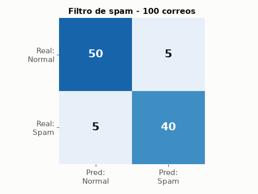

**4. Hipótesis**

> El filtro acierta en 9 de cada 10 correos.

**5. Pregunta**

¿Cuál es la exactitud del filtro y se cumple la hipótesis?

**Respuesta**

- ✅ 0.90; sí se cumple: (50 + 40) aciertos de 100.
- ❌ 0.40; no se cumple: solo cuenta los 40 spam detectados.
- ❌ 0.50; no se cumple: solo cuenta los 50 correos normales.
- ❌ 0.95; sí se cumple: solo se resta un tipo de error.

**Pista incluida en el contexto (para el docente):** El recuadro dice que los aciertos están en la diagonal (50 y 40).

**Explicación:** Exactitud = (50 + 40) / 100 = **0.90**. Los 10 errores son 5 falsos positivos y 5 falsos negativos. La hipótesis se cumple.

---

### Q13. Detector de bots: ¿sobreajuste?

**Nivel:** Fácil · **Tipo:** Verdadero / Falso · **Tema:** Sobreajuste y subajuste · **Puntaje:** 1

**1. Contexto**

Un detector de bots para el portal de inscripciones fue entrenado con un árbol de decisión muy profundo. Los resultados se muestran en el gráfico.

**Recuerda:** cuando un modelo **memoriza** los datos de entrenamiento (como un estudiante que memoriza el solucionario), obtiene notas altísimas en entrenamiento pero bajas con datos nuevos. A esto se le llama **sobreajuste (overfitting)**.

**2. Datos de muestra**

| conjunto | registros | exactitud |
|---|---|---|
| Entrenamiento | 4000 | 99 % |
| Prueba | 1000 | 62 % |

**3. Gráfico**

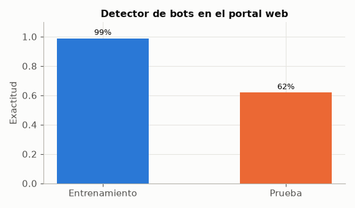

**4. Hipótesis**

> El modelo presenta sobreajuste (overfitting).

**5. Pregunta**

¿La hipótesis es verdadera o falsa?

**Respuesta**

- **VERDADERO**

**Pista incluida en el contexto (para el docente):** El recuadro describe exactamente el patrón del gráfico: muy alto en entrenamiento, bajo en prueba.

**Explicación:** **Verdadero.** Hay una brecha de 37 puntos (99 % vs 62 %): el árbol memorizó el entrenamiento. Se puede corregir limitando `max_depth`, usando más datos o un Random Forest.

---

### Q14. Roles de las columnas en el dataset de USB

**Nivel:** Fácil · **Tipo:** Emparejamiento · **Tema:** Conceptos básicos de ML · **Puntaje:** 1

**1. Contexto**

Seguridad informática quiere predecir si un dispositivo USB conectado a los equipos del laboratorio es **malicioso**. Tienen 500 dispositivos analizados: usan el 80 % para entrenar y guardan el 20 % para evaluar.

**Recuerda:** la columna que queremos **adivinar** es la *etiqueta* (y); las columnas que **usamos para adivinar** son las *variables predictoras* (X). Un código único por fila no describe al dispositivo.

**2. Datos de muestra**

| id_dispositivo | fabricante | archivos_autorun | tamaño_GB | es_malicioso |
|---|---|---|---|---|
| USB-0001 | Kingston | 0 | 16 | 0 |
| USB-0002 | Genérico | 5 | 2 | 1 |
| USB-0003 | SanDisk | 0 | 64 | 0 |
| USB-0004 | Genérico | 3 | 4 | 1 |

**3. Gráfico**

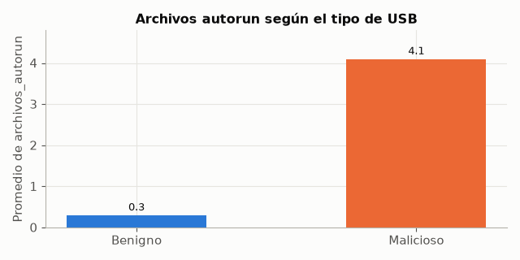

**4. Hipótesis**

> La columna `id_dispositivo` ayuda al modelo porque es diferente en cada fila.

**5. Pregunta**

Empareja cada elemento con su rol en el proyecto (sobra una opción):

**Respuesta**

- `es_malicioso` → **Variable objetivo (etiqueta, y)**
- `archivos_autorun` → **Variable predictora (feature, X)**
- `id_dispositivo` → **Identificador: no se usa para predecir**
- El 80 % de los dispositivos con los que se hace fit → **Conjunto de entrenamiento**
- El 20 % reservado para medir el desempeño → **Conjunto de prueba**
- Distractor(es): Hiperparámetro del modelo

**Pista incluida en el contexto (para el docente):** El recuadro define etiqueta (lo que se adivina), predictoras (lo que se usa) y advierte sobre los códigos únicos.

**Explicación:** `es_malicioso` es la etiqueta; `archivos_autorun` es una buena predictora (el gráfico muestra 4.1 vs 0.3 en promedio). La hipótesis es falsa: `id_dispositivo` es distinto en cada fila, no se repite en dispositivos nuevos y solo invita a memorizar.

---

### Q15. Leer un árbol de decisión de logins

**Nivel:** Fácil · **Tipo:** Selección única · **Tema:** Árboles de decisión · **Puntaje:** 1

**1. Contexto**

El sistema de autenticación usa un **árbol de decisión** para decidir qué hacer con cada inicio de sesión: permitirlo, pedir un segundo factor (2FA) o bloquearlo.

**Recuerda:** un árbol se lee **de arriba hacia abajo**: respondes la pregunta del nodo, sigues la flecha «Sí» o «No» y repites hasta llegar a una hoja (decisión final).

**2. Datos de muestra**

| login | intentos_fallidos | hora | país nuevo |
|---|---|---|---|
| L1 | 8 | 03:10 | no |
| L2 | 1 | 14:25 | sí |
| L3 | 7 | 10:40 | no |

**3. Gráfico**

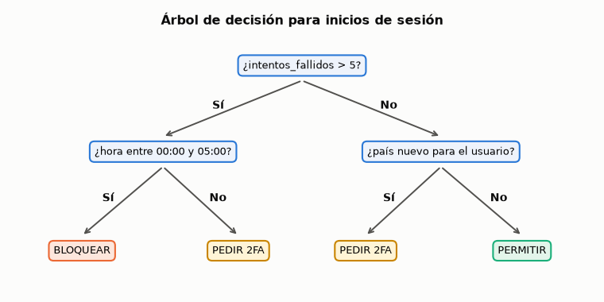

**4. Hipótesis**

> Un login con muchos intentos fallidos siempre será bloqueado.

**5. Pregunta**

¿Qué decisión toma el árbol para L1, L2 y L3?

**Respuesta**

- ✅ L1: Bloquear · L2: Pedir 2FA · L3: Pedir 2FA
- ❌ L1: Bloquear · L2: Permitir · L3: Bloquear
- ❌ L1: Pedir 2FA · L2: Pedir 2FA · L3: Bloquear
- ❌ L1: Bloquear · L2: Bloquear · L3: Bloquear

**Pista incluida en el contexto (para el docente):** El recuadro explica cómo recorrer el árbol; L3 tiene muchos intentos pero su hora no es nocturna.

**Explicación:** L1: 8 > 5 → Sí; 03:10 es nocturna → **Bloquear**. L2: 1 > 5 → No; país nuevo → **Pedir 2FA**. L3: 7 > 5 → Sí; 10:40 no es nocturna → **Pedir 2FA**. La hipótesis es falsa: L3 tiene muchos intentos y no se bloquea.

---

### Q16. El modelo que vota con muchos árboles

**Nivel:** Fácil · **Tipo:** Respuesta corta · **Tema:** Random Forest · **Puntaje:** 1

**1. Contexto**

En vez de un solo árbol de decisión, el equipo entrenó **100 árboles**. Cada árbol aprendió con una muestra **elegida al azar** de los datos y con variables elegidas al azar. Para clasificar una conexión, **cada árbol vota** y gana la mayoría.

**Recuerda:** muchos árboles juntos forman un *bosque*; y como cada árbol usa datos tomados al azar, se dice que es un bosque *aleatorio*.

**2. Datos de muestra**

| árbol | voto para la conexión #4512 |
|---|---|
| Árbol 1 | ataque |
| Árbol 2 | ataque |
| Árbol 3 | normal |
| Árbol 4 | ataque |
| … | … |
| Árbol 100 | ataque |

**3. Gráfico**

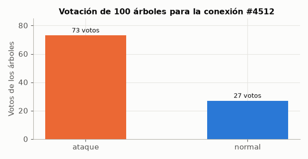

**4. Hipótesis**

> La decisión final del conjunto es «ataque», porque la mayoría de los árboles votó así.

**5. Pregunta**

La hipótesis es correcta (73 vs 27 votos). **¿Cómo se llama este modelo?** *(Puedes escribirlo en español o en inglés.)*

**Respuesta**

- Respuestas aceptadas (sin distinguir mayúsculas): `random forest`, `bosque aleatorio`, `bosques aleatorios`, `random forests`, `randomforest`, `RandomForestClassifier`, `bosque aleatorio (random forest)`, `random forest classifier`

**Pista incluida en el contexto (para el docente):** El recuadro casi deletrea el nombre: bosque + aleatorio.

**Explicación:** **Random Forest (bosque aleatorio)**. Combinar muchos árboles distintos reduce el sobreajuste de un solo árbol: los errores de algunos árboles se compensan con los aciertos de otros.

---

### Q17. Café y alertas: ¿correlación o causa?

**Nivel:** Fácil · **Tipo:** Verdadero / Falso · **Tema:** Correlación vs causalidad · **Puntaje:** 1

**1. Contexto**

Durante el cierre de gestión, el SOC registró por semana las **alertas de seguridad** y las **tazas de café** que tomaron los analistas. En esas semanas también aumentó mucho la cantidad de **usuarios activos** en los sistemas.

**Recuerda:** que dos variables suban juntas (**correlación**) no prueba que una *cause* a la otra. Puede existir una **tercera variable** que mueve a las dos.

**2. Datos de muestra**

| semana | usuarios_activos | alertas | tazas_café |
|---|---|---|---|
| 1 | 410 | 38 | 55 |
| 3 | 520 | 51 | 70 |
| 5 | 650 | 70 | 86 |
| 7 | 800 | 88 | 99 |

**3. Gráfico**

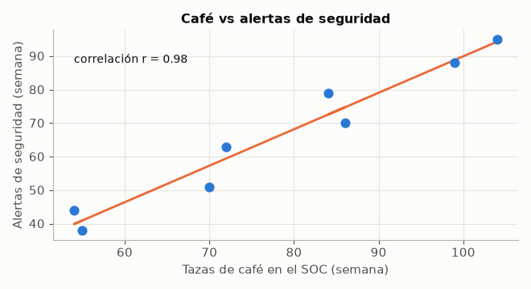

**4. Hipótesis**

> Si prohibimos el café en el SOC, las alertas de seguridad disminuirán.

**5. Pregunta**

¿La hipótesis es verdadera o falsa?

**Respuesta**

- **FALSO**

**Pista incluida en el contexto (para el docente):** El contexto menciona una tercera variable (usuarios activos) que sube junto con las otras dos.

**Explicación:** **Falso.** Café y alertas están muy correlacionados, pero ambos aumentan por una tercera variable: más usuarios activos → más alertas y más trabajo (más café). Quitar el café no reduce las alertas. Correlación ≠ causalidad.

---

### Q18. El modelo «perezoso» con 99 % de exactitud

**Nivel:** Fácil · **Tipo:** Selección única · **Tema:** Clases desbalanceadas · **Puntaje:** 1

**1. Contexto**

En una red, de 1 000 conexiones solo **10 son ataques**. Un practicante entrega un modelo que **siempre responde «normal»**, sin importar los datos de entrada.

**Recuerda:** **recall de ataques** = ataques detectados / ataques reales. Mide qué parte de los ataques logramos atrapar.

**2. Datos de muestra**

| conexión | real | predicción del modelo |
|---|---|---|
| 1 | normal | normal |
| 2 | normal | normal |
| 3 | ataque | normal |
| 4 | normal | normal |
| 5 | ataque | normal |

**3. Gráfico**

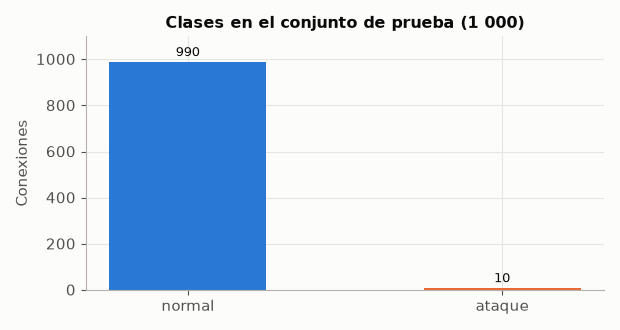

**4. Hipótesis**

> Un modelo con 99 % de exactitud es excelente para detectar ataques.

**5. Pregunta**

El modelo obtiene 990/1 000 = 99 % de exactitud. ¿Qué conclusión es correcta?

**Respuesta**

- ✅ La exactitud engaña: el modelo detecta 0 de 10 ataques (recall de ataques = 0), así que no sirve.
- ❌ El modelo es excelente: 99 % es casi perfecto.
- ❌ El problema es que hay muy pocas conexiones normales en los datos.
- ❌ Si la exactitud es 99 %, el recall también es 99 %.

**Pista incluida en el contexto (para el docente):** El recuadro da la fórmula del recall; en la tabla, los ataques reales siempre se predicen como normal.

**Explicación:** Con clases desbalanceadas (99 % normal) la exactitud puede ser alta sin detectar nada. Recall de ataques = 0/10 = 0. Hay que mirar recall, precisión y la matriz de confusión.

---

### Q19. Código de preprocesamiento para k-NN

**Nivel:** Fácil · **Tipo:** Arrastrar y soltar · **Tema:** Preprocesamiento (imputación, codificación, escalado) · **Puntaje:** 1

**1. Contexto**

Se preparan datos de un servidor web para un modelo k-NN que detecta solicitudes anómalas:

- `tiempo_respuesta_ms` tiene nulos y algunos valores extremos → rellenar con el **valor del medio** (robusto a extremos).
- `sistema_operativo` (Windows, Linux, macOS) no tiene orden → crear **una columna 0/1 por categoría**.
- k-NN usa distancias → dejar todas las variables con **media 0 y desviación 1**.

**2. Datos de muestra**

| solicitud | tiempo_respuesta_ms | sistema_operativo | bytes |
|---|---|---|---|
| 1 | 142 | Windows | 5300 |
| 2 | *NaN* | Linux | 880 |
| 3 | 2310 | macOS | 120 |
| 4 | 161 | Windows | 4100 |

**3. Gráfico**

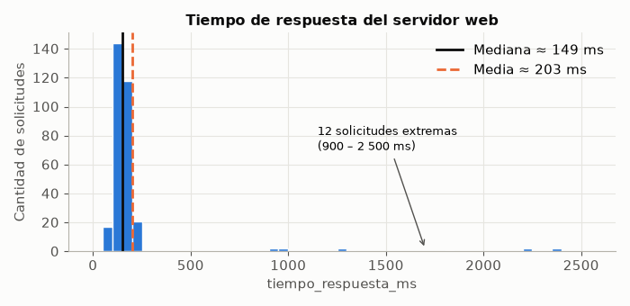

**4. Hipótesis**

> La media es la mejor opción para rellenar los nulos de `tiempo_respuesta_ms`.

**5. Pregunta**

Arrastra las opciones para completar el código:

```python
from sklearn.impute import SimpleImputer
from sklearn.preprocessing import OneHotEncoder, OrdinalEncoder, StandardScaler

imputador   = SimpleImputer(strategy="[[1→median]]")
codificador = [[2→OneHotEncoder]](handle_unknown="ignore")
escalador   = [[3→StandardScaler]]()
```

**Respuesta**

- [[1]] → **median** (grupo 1)
- [[2]] → **OneHotEncoder** (grupo 2)
- [[3]] → **StandardScaler** (grupo 3)
- Distractores: `mean` (g1), `OrdinalEncoder` (g2), `RandomForestClassifier` (g3)

**Pista incluida en el contexto (para el docente):** Cada viñeta del contexto describe con palabras el paso: valor del medio, columna 0/1 por categoría, media 0 y desviación 1.

**Explicación:** `median`: el histograma muestra valores extremos que inflan la media, así que la hipótesis es falsa. `OneHotEncoder`: categorías sin orden. `StandardScaler`: media 0 y desviación 1 para que ninguna variable domine la distancia de k-NN.

---

### Q20. Predecir incidentes con regresión lineal

**Nivel:** Fácil · **Tipo:** Selección única · **Tema:** Regresión lineal · **Puntaje:** 1

**1. Contexto**

La Dirección de TI ajustó una regresión lineal para estimar los **incidentes de seguridad por mes** de cada área según sus **equipos sin parche**:

`incidentes = 12 + 3 × equipos_sin_parche`

**Recuerda:** para predecir, **reemplaza x** en la ecuación por el valor que te dan y resuelve (primero la multiplicación, luego la suma).

**2. Datos de muestra**

| área | equipos_sin_parche | incidentes reales |
|---|---|---|
| Contabilidad | 4 | 25 |
| Ventas | 10 | 41 |
| Sistemas | 2 | 17 |
| Biblioteca | 15 | 58 |
| RRHH | 7 | 32 |

**3. Gráfico**

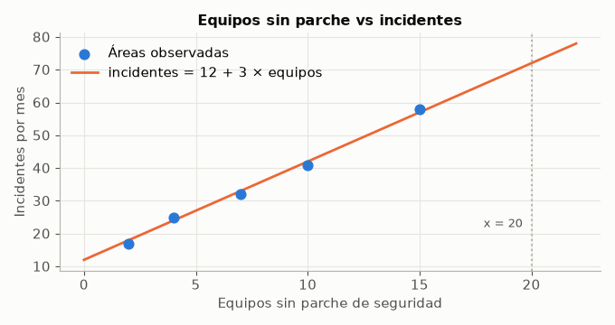

**4. Hipótesis**

> Si un área tiene 20 equipos sin parche, el modelo predice más de 70 incidentes al mes.

**5. Pregunta**

¿Cuántos incidentes predice el modelo para 20 equipos y se cumple la hipótesis?

**Respuesta**

- ✅ 72 incidentes; sí se cumple.
- ❌ 60 incidentes; no se cumple.
- ❌ 35 incidentes; no se cumple.
- ❌ 240 incidentes; sí se cumple.

**Pista incluida en el contexto (para el docente):** El recuadro indica reemplazar x = 20 y multiplicar antes de sumar.

**Explicación:** 12 + 3 × 20 = 12 + 60 = **72** > 70 → la hipótesis se cumple. Error común: 3 × 20 = 60 (olvidar el intercepto) o 12 × 20 = 240 (multiplicar el intercepto en lugar de la pendiente).

---

### Q21. Métricas del IDS desde la matriz de confusión

**Nivel:** Intermedio · **Tipo:** Completar · **Tema:** Precisión, recall y exactitud · **Puntaje:** según huecos

**1. Contexto**

Un sistema de detección de intrusiones (IDS) se evaluó con 1 000 conexiones. «Positivo» = *ataque*.

**Recuerda:** **Precisión** = TP / (TP + FP): de las alarmas, ¿cuántas eran ataques reales?  
**Recall** = TP / (TP + FN): de los ataques reales, ¿cuántos detectamos?  
**Exactitud** = (TP + TN) / total.

**2. Datos de muestra**

| conexión | predicción | real | celda |
|---|---|---|---|
| #101 | ataque | ataque | TP |
| #102 | ataque | normal | FP |
| #103 | normal | ataque | FN |
| #104 | normal | normal | TN |

**3. Gráfico**

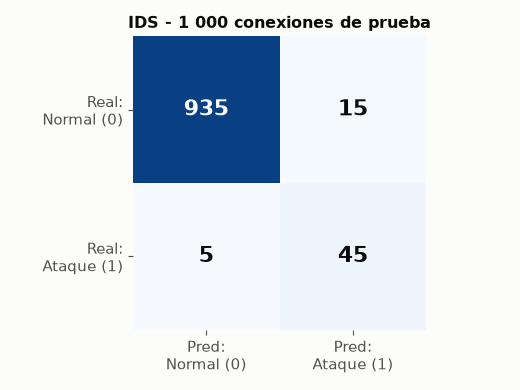

**4. Hipótesis**

> El IDS detecta 9 de cada 10 ataques reales.

**5. Pregunta**

Completa con los datos de la matriz:

- TP = `____` **[45]** · FP = `____` **[15]** · FN = `____` **[5]**
- Precisión = `____` **[0.75 ± 0.005]**
- Recall = `____` **[0.90 ± 0.005]**
- Exactitud = `____` **[0.98 ± 0.005]**
- De cada 4 alarmas, aproximadamente `▾ (3 / 1 / 2 / 4)` **[3]** son ataques reales.
- La hipótesis `▾ (se cumple / no se cumple)` **[se cumple]**.
*Usa punto decimal (ej. 0.75). Se acepta un margen de ±0.005.*

**Respuesta**

- Ver valores entre corchetes en la pregunta.

**Pista incluida en el contexto (para el docente):** El recuadro trae las tres fórmulas y la tabla muestra cómo se nombra cada celda.

**Explicación:** Precisión = 45/60 = 0.75 (3 de cada 4 alarmas son reales). Recall = 45/50 = 0.90 → la hipótesis se cumple. Exactitud = (45 + 935)/1 000 = 0.98.

---

### Q22. Ransomware: ¿precisión o recall?

**Nivel:** Intermedio · **Tipo:** Selección única · **Tema:** Precisión vs recall · **Puntaje:** 2

**1. Contexto**

Dos modelos detectan ransomware en los servidores de la universidad. Si un ransomware **no se detecta**, puede cifrar todos los servidores (días sin sistema académico). Si hay una **falsa alarma**, un analista revisa el servidor durante 5 minutos.

**Recuerda:** **Recall** alto = se escapan pocos ataques. **Precisión** alta = pocas falsas alarmas. Se prioriza la métrica asociada al error *más costoso*.

**2. Datos de muestra**

| modelo | exactitud | precisión | recall |
|---|---|---|---|
| A | 0.97 | 0.95 | 0.6 |
| B | 0.95 | 0.7 | 0.96 |

**3. Gráfico**

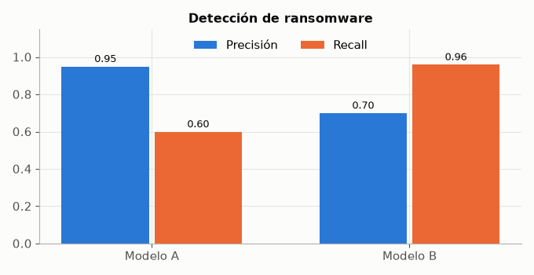

**4. Hipótesis**

> Debemos elegir el Modelo A porque tiene mayor exactitud y mayor precisión.

**5. Pregunta**

¿Qué modelo conviene y por qué?

**Respuesta**

- ✅ Modelo B: su recall es 0.96, deja escapar muy pocos ransomware; las falsas alarmas cuestan poco.
- ❌ Modelo A: su exactitud es mayor, y la exactitud siempre es la métrica principal.
- ❌ Modelo A: con precisión 0.95 casi no molesta a los analistas, que es lo más importante.
- ❌ Ninguno: con exactitudes de 0.95 y 0.97 los dos son equivalentes.

**Pista incluida en el contexto (para el docente):** El contexto compara el costo de cada error; el recuadro dice qué métrica protege del error caro.

**Explicación:** El error caro es el falso negativo (ransomware no detectado), así que se prioriza el recall. El Modelo A deja escapar 40 % de los ransomware. La hipótesis es falsa.

---

### Q23. Elegir el mejor k para k-NN

**Nivel:** Intermedio · **Tipo:** Selección única · **Tema:** k-NN y sobreajuste · **Puntaje:** 2

**1. Contexto**

Se usa k-NN para detectar cámaras IoT comprometidas en la red del campus. Se probaron varios valores de k.

**Recuerda:** con **k muy pequeño** el modelo copia el ruido (memoriza); con **k muy grande** se vuelve demasiado simple. Se elige el k con **mejor validación**, no con mejor entrenamiento.

**2. Datos de muestra**

| k | exactitud entrenamiento | exactitud validación |
|---|---|---|
| 1 | 1.00 | 0.78 |
| 3 | 0.95 | 0.85 |
| 5 | 0.93 | 0.88 |
| 7 | 0.92 | 0.91 |
| 9 | 0.91 | 0.90 |
| 11 | 0.90 | 0.89 |
| 15 | 0.88 | 0.87 |
| 21 | 0.86 | 0.84 |
| 31 | 0.83 | 0.80 |

**3. Gráfico**

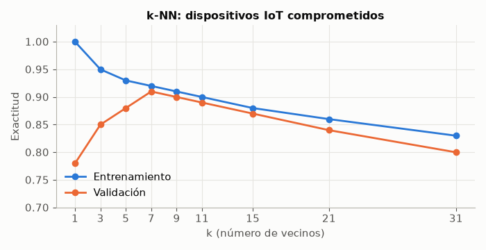

**4. Hipótesis**

> k = 1 es el mejor valor porque obtiene 100 % en entrenamiento.

**5. Pregunta**

¿Qué valor de k conviene elegir?

**Respuesta**

- ✅ k = 7: tiene la mayor exactitud de validación (0.91); con k = 1 hay sobreajuste.
- ❌ k = 1: tiene 100 % en entrenamiento.
- ❌ k = 31: es el modelo más simple, por lo tanto el mejor.
- ❌ k = 3: es el segundo mejor en entrenamiento.

**Pista incluida en el contexto (para el docente):** El recuadro dice que se elige por validación: buscar el punto más alto de la curva naranja.

**Explicación:** La validación es máxima en k = 7 (0.91). k = 1: 1.00 vs 0.78 → sobreajuste. k = 31: ambas bajan → subajuste.

---

### Q24. Distancia euclidiana y votación en k-NN

**Nivel:** Intermedio · **Tipo:** Completar · **Tema:** k-NN: distancia euclidiana · **Puntaje:** según huecos

**1. Contexto**

Las variables ya están escaladas entre 0 y 1. Llega un login nuevo **N = (0.2, 0.8)**.

**Recuerda:** distancia euclidiana: `d = √((x1 − x1')² + (x2 − x2')²)`. Ejemplo: entre (0, 0) y (0.3, 0.4) → √(0.09 + 0.16) = √0.25 = 0.5.

**2. Datos de muestra**

| punto | x1 | x2 | clase |
|---|---|---|---|
| A | 0.5 | 0.4 | ataque |
| B | 0.2 | 0.5 | normal |
| C | 0.6 | 0.8 | ataque |
| D | 0.9 | 0.1 | normal |

**3. Gráfico**

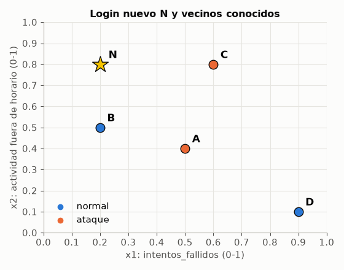

**4. Hipótesis**

> El resultado de k-NN puede cambiar según el valor de k.

**5. Pregunta**

Completa:

- d(N, A) = `____` **[0.5 ± 0.005]**
- d(N, B) = `____` **[0.3 ± 0.005]**
- d(N, C) = `____` **[0.4 ± 0.005]**
- El vecino más cercano es `▾ (B / A / C / D)` **[B]**
- Con k = 1, N se clasifica como `▾ (normal / ataque)` **[normal]**
- Con k = 3, N se clasifica como `▾ (ataque / normal)` **[ataque]**
- La hipótesis `▾ (se cumple / no se cumple)` **[se cumple]**
*Usa punto decimal (ej. 0.75). Se acepta un margen de ±0.005.*

**Respuesta**

- Ver valores entre corchetes en la pregunta.

**Pista incluida en el contexto (para el docente):** El recuadro trae la fórmula y un ejemplo con la misma estructura que d(N, A).

**Explicación:** d(N,A) = √(0.3² + 0.4²) = 0.5; d(N,B) = √(0² + 0.3²) = 0.3; d(N,C) = √(0.4² + 0²) = 0.4; d(N,D) = √(0.7² + 0.7²) ≈ 0.99. k = 1 → B (normal). k = 3 → B, C, A → 2 ataques vs 1 normal → ataque. El resultado cambia con k: la hipótesis se cumple.

---

### Q25. Valor z (StandardScaler) de un pico de logins

**Nivel:** Intermedio · **Tipo:** Respuesta corta · **Tema:** Escalado: estandarización · **Puntaje:** 2

**1. Contexto**

Históricamente, el servidor VPN recibe en promedio **50** inicios de sesión por hora con una desviación estándar de **10**. A las 03:00 hubo un pico.

**Recuerda:** `StandardScaler` transforma cada valor en **z = (x − media) / desviación**. z indica a cuántas desviaciones estándar está el valor de la media.

**2. Datos de muestra**

| hora | inicios de sesión |
|---|---|
| 00h | 48 |
| 01h | 52 |
| 02h | 45 |
| 03h | 80 |
| 04h | 51 |
| 05h | 49 |
| 06h | 55 |

**3. Gráfico**

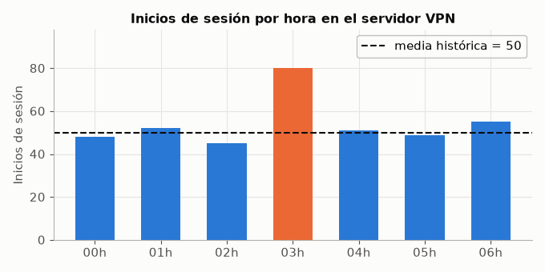

**4. Hipótesis**

> Un valor z mayor a 2 indica que la hora es inusual y merece revisión.

**5. Pregunta**

Calcula el valor **z** de las 03:00. *(Escribe solo el número.)*

**Respuesta**

- Respuestas aceptadas (sin distinguir mayúsculas): `3`, `3.0`, `3,0`, `+3`, `3.00`

**Pista incluida en el contexto (para el docente):** El recuadro trae la fórmula; los valores de x (tabla), media y desviación (contexto) están dados.

**Explicación:** z = (80 − 50) / 10 = **3**. Está a 3 desviaciones de la media: según la hipótesis es una hora inusual que merece revisión (posible ataque de fuerza bruta).

---

### Q26. Diagnóstico: subajuste, sobreajuste o buen ajuste

**Nivel:** Intermedio · **Tipo:** Emparejamiento · **Tema:** Sobreajuste y subajuste · **Puntaje:** 2

**1. Contexto**

El equipo de correo institucional entrenó tres filtros de spam con distinta complejidad.

**Recuerda:** compara dos cosas: (1) ¿qué tan **alto** es el desempeño? y (2) ¿qué tan **separadas** están las barras de entrenamiento y prueba? Bajo y juntas = no aprendió; alto en entrenamiento pero separadas = memorizó; altas y juntas = generaliza.

**2. Datos de muestra**

| modelo | exactitud entrenamiento | exactitud prueba |
|---|---|---|
| Modelo A | 0.61 | 0.59 |
| Modelo B | 0.99 | 0.71 |
| Modelo C | 0.9 | 0.88 |

**3. Gráfico**

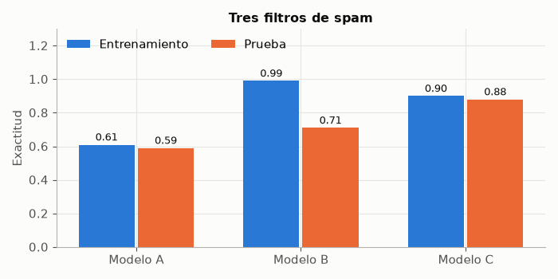

**4. Hipótesis**

> El Modelo B es el mejor porque tiene la mayor exactitud de entrenamiento.

**5. Pregunta**

Empareja cada modelo con su diagnóstico (sobra una opción):

**Respuesta**

- Modelo A → **Subajuste (underfitting)**
- Modelo B → **Sobreajuste (overfitting)**
- Modelo C → **Buen ajuste (generaliza bien)**
- Distractor(es): Fuga de información (data leakage)

**Pista incluida en el contexto (para el docente):** El recuadro traduce cada patrón de barras a un diagnóstico.

**Explicación:** A: ambas bajas (≈0.60) → subajuste. B: 0.99 vs 0.71 → sobreajuste. C: altas y cercanas → buen ajuste. La hipótesis es falsa: el mejor es C (mayor exactitud de prueba).

---

### Q27. Naive Bayes: la palabra «urgente»

**Nivel:** Intermedio · **Tipo:** Completar · **Tema:** Naive Bayes / Teorema de Bayes · **Puntaje:** según huecos

**1. Contexto**

Un filtro Naive Bayes analiza correos. Del histórico se sabe que el 30 % de los correos son phishing; la palabra **«urgente»** aparece en el 60 % de los phishing y en el 10 % de los legítimos.

**Recuerda:** piensa en 100 correos: 30 phishing y 70 legítimos. ¿Cuántos de cada grupo dicen «urgente»?  
`P(phishing | urgente) = P(urgente y phishing) / P(urgente)`

**2. Datos de muestra**

| correo | contiene «urgente» | clase |
|---|---|---|
| #1 | sí | phishing |
| #2 | no | legítimo |
| #3 | sí | legítimo |
| #4 | sí | phishing |
| #5 | no | phishing |

**3. Gráfico**

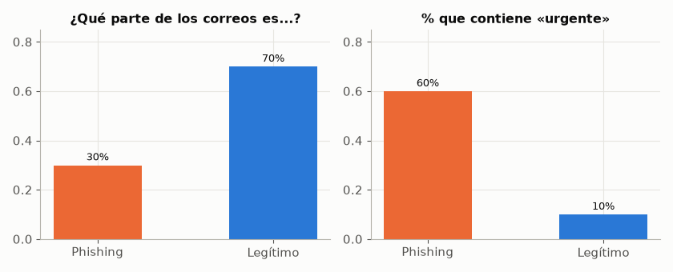

**4. Hipótesis**

> Si un correo contiene «urgente», es más probable que sea phishing que legítimo.

**5. Pregunta**

Completa (como proporciones):

- P(urgente y phishing) = 0.30 × 0.60 = `____` **[0.18 ± 0.005]**
- P(urgente y legítimo) = 0.70 × 0.10 = `____` **[0.07 ± 0.005]**
- P(urgente) = `____` **[0.25 ± 0.005]**
- P(phishing | urgente) = `____` **[0.72 ± 0.005]**
- Un correo con «urgente» se clasifica como `▾ (phishing / legítimo)` **[phishing]** y la hipótesis `▾ (se cumple / no se cumple)` **[se cumple]**
*Usa punto decimal (ej. 0.75). Se acepta un margen de ±0.005.*

**Respuesta**

- Ver valores entre corchetes en la pregunta.

**Pista incluida en el contexto (para el docente):** El recuadro sugiere pensar en 100 correos: 18 phishing con «urgente» y 7 legítimos con «urgente».

**Explicación:** De 100 correos: 18 phishing y 7 legítimos contienen «urgente» → 25 en total. P(phishing | urgente) = 18/25 = 0.72 > 0.5 → phishing. La hipótesis se cumple.

---

### Q28. Supuesto de independencia de Naive Bayes

**Nivel:** Intermedio · **Tipo:** Verdadero / Falso · **Tema:** Naive Bayes: supuestos · **Puntaje:** 2

**1. Contexto**

Un filtro Naive Bayes usa, entre otras, las variables `num_enlaces` y `num_urls_acortadas` (bit.ly, tinyurl…).

**Recuerda:** Naive Bayes es «ingenuo» porque **supone que las variables son independientes** dentro de cada clase. Si conocer una variable te permite *adivinar* la otra, no son independientes.

**2. Datos de muestra**

| correo | num_enlaces | num_urls_acortadas |
|---|---|---|
| #1 | 4 | 3 |
| #2 | 4 | 2 |
| #3 | 20 | 10 |
| #4 | 12 | 7 |
| #5 | 15 | 9 |

**3. Gráfico**

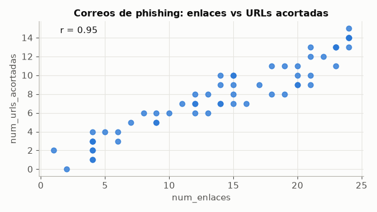

**4. Hipótesis**

> En este dataset se cumple el supuesto de independencia de Naive Bayes entre `num_enlaces` y `num_urls_acortadas`.

**5. Pregunta**

Observa el gráfico. ¿La hipótesis es verdadera o falsa?

**Respuesta**

- **FALSO**

**Pista incluida en el contexto (para el docente):** El recuadro da el criterio (¿una permite adivinar la otra?) y el gráfico muestra r cercano a 1.

**Explicación:** **Falso.** La correlación es r = 0.95: a más enlaces, más URLs acortadas. El supuesto se rompe; Naive Bayes «cuenta dos veces» la misma evidencia. A veces igual funciona bien, pero conviene saberlo (o quedarse con una de las dos variables).

---

### Q29. Validación cruzada inestable

**Nivel:** Intermedio · **Tipo:** Selección única · **Tema:** Validación cruzada · **Puntaje:** 2

**1. Contexto**

Se evaluó un clasificador de malware con **validación cruzada de 5 folds**.

**Recuerda:** en validación cruzada se entrena y evalúa 5 veces, cada vez con una parte distinta como prueba. Se reporta el **promedio**; si los folds **varían mucho**, el modelo es inestable o alguna parte de los datos es diferente.

**2. Datos de muestra**

| fold | exactitud |
|---|---|
| 1 | 0.91 |
| 2 | 0.62 |
| 3 | 0.93 |
| 4 | 0.9 |
| 5 | 0.92 |

**3. Gráfico**

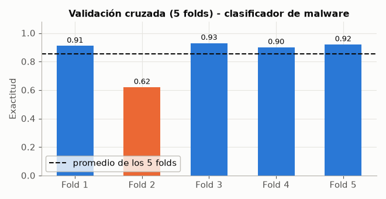

**4. Hipótesis**

> El modelo tiene un desempeño estable de alrededor de 0.90 en cualquier parte de los datos.

**5. Pregunta**

¿Qué conclusión es correcta?

**Respuesta**

- ✅ La hipótesis es falsa: el promedio es ≈ 0.86 y el fold 2 (0.62) muestra inestabilidad; hay que revisar qué datos contiene ese fold.
- ❌ La hipótesis es verdadera: se debe reportar 0.93, el mejor fold.
- ❌ La hipótesis es verdadera: los folds bajos son errores y se eliminan del promedio.
- ❌ La hipótesis es falsa porque la validación cruzada solo sirve para regresión.

**Pista incluida en el contexto (para el docente):** El recuadro dice que se reporta el promedio y que mucha variación indica inestabilidad.

**Explicación:** Promedio = (0.91 + 0.62 + 0.93 + 0.90 + 0.92) / 5 = 0.856. El fold 2 cae a 0.62: tal vez contiene una familia de malware que no aparece en los otros folds. No se eliminan resultados incómodos.

---

### Q30. Pipeline: escalado + k-NN con validación cruzada

**Nivel:** Intermedio · **Tipo:** Arrastrar y soltar · **Tema:** Pipelines y validación cruzada · **Puntaje:** 2

**1. Contexto**

Para clasificar tráfico como normal/ataque con k-NN, el equipo usa un **Pipeline**: primero **estandariza** (media 0, desviación 1) y luego aplica el **clasificador** de vecinos. El desempeño se mide con **validación cruzada de 5 folds**.

**Recuerda:** los clasificadores terminan en `Classifier` y los de regresión en `Regressor`. `cross_val_score` hace la validación cruzada; `train_test_split` solo divide una vez.

**2. Datos de muestra**

| paquetes | bytes | duración (s) | clase |
|---|---|---|---|
| 120 | 54000 | 3.2 | 0 |
| 950 | 61000 | 0.4 | 1 |
| 64 | 9800 | 1.1 | 0 |

**3. Gráfico**

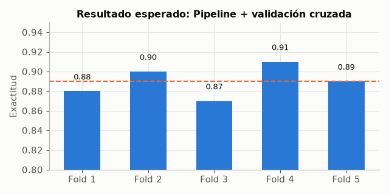

**4. Hipótesis**

> Con el Pipeline, el escalador se ajusta solo con los datos de entrenamiento de cada fold, evitando fuga de información.

**5. Pregunta**

Arrastra las opciones para completar el código:

```python
pipe = Pipeline([
    ("escalar", [[1→StandardScaler]]()),
    ("modelo",  [[2→KNeighborsClassifier]](n_neighbors=5))
])
scores = [[3→cross_val_score]](pipe, X, y, cv=[[4→5]])
print(scores.mean())
```

**Respuesta**

- [[1]] → **StandardScaler** (grupo 1)
- [[2]] → **KNeighborsClassifier** (grupo 2)
- [[3]] → **cross_val_score** (grupo 3)
- [[4]] → **5** (grupo 4)
- Distractores: `OneHotEncoder` (g1), `KNeighborsRegressor` (g2), `train_test_split` (g3), `0.2` (g4)

**Pista incluida en el contexto (para el docente):** El contexto describe cada paso con palabras y el recuadro diferencia Classifier/Regressor y las dos funciones.

**Explicación:** `StandardScaler` → `KNeighborsClassifier` (es clasificación) → `cross_val_score(pipe, X, y, cv=5)`. La hipótesis es verdadera: dentro de cada fold el Pipeline hace `fit` del escalador solo con la parte de entrenamiento.

---

### Q31. Elegir el umbral según la política del SOC

**Nivel:** Intermedio · **Tipo:** Selección única · **Tema:** Umbral de decisión · **Puntaje:** 2

**1. Contexto**

Una regresión logística detecta phishing. La política del SOC dice: **detectar al menos el 90 % del phishing** (recall ≥ 0.90) y, entre los umbrales que cumplan eso, elegir el de **mayor precisión** para no saturar a los analistas.

**Recuerda:** al **subir** el umbral, el modelo es más exigente: sube la precisión y baja el recall. Primero filtra los umbrales que cumplen la condición y luego compara.

**2. Datos de muestra**

| umbral | precisión | recall |
|---|---|---|
| 0.1 | 0.4 | 0.99 |
| 0.2 | 0.52 | 0.97 |
| 0.3 | 0.63 | 0.94 |
| 0.4 | 0.72 | 0.91 |
| 0.5 | 0.8 | 0.85 |
| 0.6 | 0.86 | 0.78 |
| 0.7 | 0.91 | 0.69 |
| 0.8 | 0.95 | 0.55 |
| 0.9 | 0.98 | 0.38 |

**3. Gráfico**

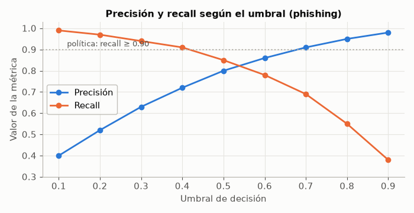

**4. Hipótesis**

> El umbral por defecto (0.5) cumple la política del SOC.

**5. Pregunta**

¿Qué umbral se debe elegir?

**Respuesta**

- ✅ 0.4: es el umbral más alto con recall ≥ 0.90 (0.91), y por eso el de mayor precisión (0.72) entre los que cumplen.
- ❌ 0.5: es el valor por defecto y cumple la política.
- ❌ 0.1: tiene el mayor recall (0.99).
- ❌ 0.9: tiene la mayor precisión (0.98).

**Pista incluida en el contexto (para el docente):** El recuadro indica el orden: primero filtrar recall ≥ 0.90 (0.1 a 0.4), luego la mayor precisión.

**Explicación:** Cumplen recall ≥ 0.90: 0.1, 0.2, 0.3 y 0.4. De ellos, la mayor precisión es la de 0.4 (0.72). Con 0.5 el recall es 0.85 → la hipótesis es falsa.

---

### Q32. Interpretar la importancia de variables

**Nivel:** Intermedio · **Tipo:** Selección única · **Tema:** Random Forest: importancia de variables · **Puntaje:** 2

**1. Contexto**

Un Random Forest detecta cuentas de correo comprometidas. Se graficó `feature_importances_`.

**Recuerda:** la importancia mide **cuánto ayudó cada variable al bosque a separar las clases**. No indica causa, ni dirección (si sube o baja el riesgo), y las importancias suman 1.

**2. Datos de muestra**

| variable | importancia |
|---|---|
| intentos_fallidos_1h | 0.42 |
| pais_distinto_habitual | 0.27 |
| hora_login | 0.15 |
| tipo_navegador | 0.1 |
| longitud_usuario | 0.06 |

**3. Gráfico**

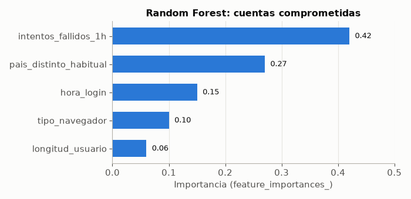

**4. Hipótesis**

> `intentos_fallidos_1h` es la variable que más aporta al modelo para separar cuentas comprometidas de cuentas normales.

**5. Pregunta**

¿Qué afirmación es correcta?

**Respuesta**

- ✅ La hipótesis es verdadera: intentos_fallidos_1h es la más útil para separar; longitud_usuario aporta poco y se podría probar quitarla.
- ❌ Tener muchos intentos fallidos causa que una cuenta sea comprometida, porque su importancia es 0.42.
- ❌ hora_login decide exactamente el 15 % de los casos.
- ❌ longitud_usuario es la más importante porque tiene el valor más pequeño.

**Pista incluida en el contexto (para el docente):** El recuadro advierte que importancia ≠ causa y ≠ porcentaje de casos.

**Explicación:** La importancia es una medida de utilidad para las divisiones del bosque, no de causalidad. longitud_usuario (0.06) es candidata a eliminarse y volver a evaluar.

---

### Q33. ¿Cómo se llama el problema del 99.8 %?

**Nivel:** Intermedio · **Tipo:** Respuesta corta · **Tema:** Fuga de información (data leakage) · **Puntaje:** 2

**1. Contexto**

El SOC quiere predecir, **en el momento en que llega una alerta**, si terminará siendo un incidente real. Un modelo logró 99.8 % de exactitud. La columna `estado_final_ticket` la escribe el analista **días después**, cuando cierra el caso.

**Recuerda:** pregúntate: *¿esa información existe en el momento en que el modelo debe predecir?* Cuando datos del futuro (o la propia respuesta) se «filtran» a las variables de entrada, el modelo hace trampa.

**2. Datos de muestra**

| alerta | severidad_alerta | ip_en_lista_negra | estado_final_ticket | fue_incidente (y) |
|---|---|---|---|---|
| A-301 | alta | sí | cerrado: incidente | 1 |
| A-302 | baja | no | cerrado: falso positivo | 0 |
| A-303 | media | no | cerrado: falso positivo | 0 |

**3. Gráfico**

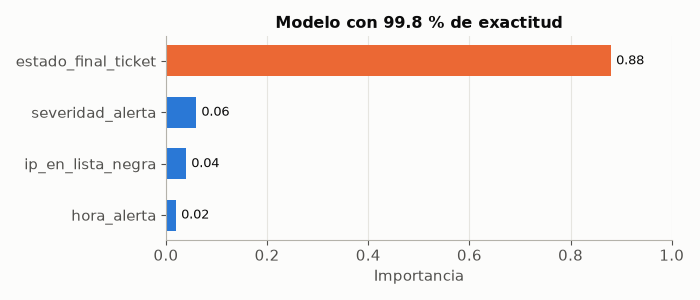

**4. Hipótesis**

> El 99.8 % de exactitud se mantendrá cuando el modelo se use en tiempo real.

**5. Pregunta**

La hipótesis es falsa. ¿Cómo se llama este problema? *(en español o inglés)*

**Respuesta**

- Respuestas aceptadas (sin distinguir mayúsculas): `fuga de datos`, `fuga de información`, `fuga de informacion`, `data leakage`, `leakage`, `filtración de datos`, `filtracion de datos`, `fuga de informacion (data leakage)`, `fuga`

**Pista incluida en el contexto (para el docente):** El recuadro usa la palabra «se filtran»; en inglés el término es leakage.

**Explicación:** **Fuga de información (data leakage)**: `estado_final_ticket` contiene la respuesta y no existe al momento de predecir. Hay que eliminarla y reentrenar.

---

### Q34. Imputar nulos: ¿media o mediana?

**Nivel:** Intermedio · **Tipo:** Selección única · **Tema:** Imputación de valores nulos · **Puntaje:** 2

**1. Contexto**

El 6 % de las mediciones de `tiempo_respuesta` del portal están vacías (el monitor se reinició). Durante algunos minutos hubo un ataque DDoS con tiempos altísimos.

**Recuerda:** la **media** se «jala» hacia los valores extremos; la **mediana** (valor del medio) casi no cambia con ellos.

**2. Datos de muestra**

| medición | tiempo_respuesta (ms) |
|---|---|
| 1 | 162 |
| 2 | *NaN* |
| 3 | 3980 |
| 4 | 175 |
| 5 | 148 |

**3. Gráfico**

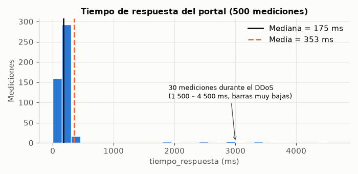

**4. Hipótesis**

> Rellenar los nulos con la media (353 ms) representa bien un tiempo de respuesta típico.

**5. Pregunta**

¿Qué valor conviene usar para imputar?

**Respuesta**

- ✅ La mediana (175 ms): la distribución tiene cola larga y la media está inflada por los minutos de DDoS.
- ❌ La media (353 ms): siempre es la mejor medida del centro.
- ❌ 0 ms: si no hay dato, el portal no respondió.
- ❌ El valor máximo, para ser conservadores.

**Pista incluida en el contexto (para el docente):** El recuadro explica cuál de las dos líneas es sensible a extremos; el gráfico muestra la cola por DDoS.

**Explicación:** La media (353 ms) queda lejos de la mayoría de datos por los valores de DDoS; la mediana (175 ms) representa el caso típico. La hipótesis es falsa.

---

### Q35. Error absoluto medio (MAE) del modelo de VPN

**Nivel:** Intermedio · **Tipo:** Selección única · **Tema:** Regresión: métricas de error · **Puntaje:** 2

**1. Contexto**

Una regresión lineal predice cuántas conexiones VPN habrá cada día para dimensionar el servidor.

**Recuerda:** **error = real − predicho**. El **MAE** es el promedio de los errores en **valor absoluto** (sin signo), para que los positivos y negativos no se cancelen.

**2. Datos de muestra**

| día | real | predicho |
|---|---|---|
| Lun | 120 | 118 |
| Mar | 95 | 99 |
| Mié | 140 | 139 |
| Jue | 110 | 113 |

**3. Gráfico**

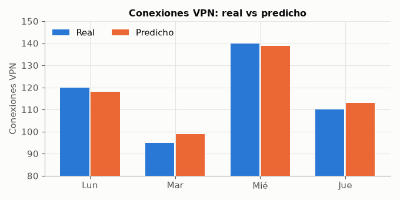

**4. Hipótesis**

> En promedio, el modelo se equivoca en menos de 3 conexiones por día.

**5. Pregunta**

¿Cuál es el MAE y se cumple la hipótesis?

**Respuesta**

- ✅ MAE = 2.5; sí se cumple.
- ❌ MAE = −1.0; sí se cumple.
- ❌ MAE = 10; no se cumple.
- ❌ MAE = 0; los errores se cancelan.

**Pista incluida en el contexto (para el docente):** El recuadro dice que se toma el valor absoluto antes de promediar.

**Explicación:** Errores: 2, −4, 1, −3 → absolutos 2, 4, 1, 3 → MAE = 10/4 = **2.5** < 3. Si no se usa valor absoluto: (2 − 4 + 1 − 3)/4 = −1, que no tiene sentido como «tamaño» del error.

---

### Q36. ¿El escalado mejora a todos los modelos?

**Nivel:** Intermedio · **Tipo:** Verdadero / Falso · **Tema:** Escalado y tipo de modelo · **Puntaje:** 2

**1. Contexto**

Se compararon un árbol de decisión y k-NN para detectar escaneos de puertos, con y sin escalar las variables (`bytes`, `puertos_distintos`, `duración`).

**Recuerda:** un árbol hace preguntas del tipo *«¿puertos_distintos > 100?»*. Escalar solo cambia el número de corte, no el orden de los datos. k-NN, en cambio, calcula distancias.

**2. Datos de muestra**

| modelo | sin escalar | con StandardScaler |
|---|---|---|
| Árbol | 0.91 | 0.91 |
| k-NN | 0.72 | 0.9 |

**3. Gráfico**

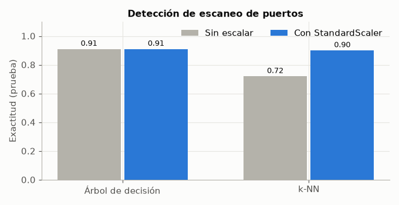

**4. Hipótesis**

> Escalar las variables mejora a ambos modelos por igual.

**5. Pregunta**

¿La hipótesis es verdadera o falsa?

**Respuesta**

- **FALSO**

**Pista incluida en el contexto (para el docente):** El recuadro explica por qué un árbol no depende de la escala; el gráfico lo confirma.

**Explicación:** **Falso.** El árbol queda igual (0.91 → 0.91) porque solo compara valores con un corte. k-NN mejora mucho (0.72 → 0.90) porque depende de distancias.

---

### Q37. Seleccionar variables irrelevantes

**Nivel:** Intermedio · **Tipo:** Selección múltiple (varias correctas) · **Tema:** Selección de variables · **Puntaje:** 2

**1. Contexto**

Se quiere predecir si una computadora del laboratorio **se infectará** con malware el próximo mes. El dataset tiene variables útiles y otras que se agregaron «por si acaso».

**Recuerda:** para decidir, combina dos criterios: (1) ¿tiene **lógica** que la variable influya en una infección? y (2) ¿su **relación** con la etiqueta es casi cero?

**2. Datos de muestra**

| equipo | dias_sin_actualizar | usuario_es_admin | numero_de_escritorio | color_fondo_pantalla | infectado |
|---|---|---|---|---|---|
| LAB-01 | 3 | no | 12 | azul | 0 |
| LAB-02 | 95 | sí | 7 | negro | 1 |
| LAB-03 | 40 | sí | 3 | azul | 1 |

**3. Gráfico**

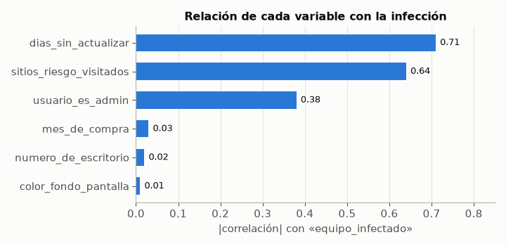

**4. Hipótesis**

> Mientras más columnas tenga el modelo, mejor será su predicción.

**5. Pregunta**

Selecciona **todas** las variables que conviene **eliminar**:

**Respuesta**

- ✅ numero_de_escritorio
- ✅ color_fondo_pantalla
- ✅ mes_de_compra
- ❌ dias_sin_actualizar
- ❌ usuario_es_admin

**Pista incluida en el contexto (para el docente):** El recuadro da los dos criterios: sin lógica y con correlación casi cero.

**Explicación:** Las tres últimas no tienen relación lógica con una infección y su correlación es ≈ 0: solo agregan ruido. La hipótesis es falsa: más columnas irrelevantes pueden empeorar modelos como k-NN.

---

### Q38. Regresión lineal: restaurar un respaldo

**Nivel:** Intermedio · **Tipo:** Completar · **Tema:** Regresión lineal: predicción y residuo · **Puntaje:** según huecos

**1. Contexto**

Tras un ataque, TI debe restaurar servidores desde respaldos. Se ajustó:

`minutos = 15 + 2.5 × GB`

**Recuerda:** en `y = b + m·x`: `b` es el **intercepto** (valor cuando x = 0) y `m` la **pendiente**. El **residuo** = real − predicho. 2 horas = 120 minutos.

**2. Datos de muestra**

| respaldo (GB) | minutos reales |
|---|---|
| 10 | 42 |
| 20 | 63 |
| 30 | 92 |
| 50 | 141 |
| 60 | 162 |
| 40 | 130 |

**3. Gráfico**

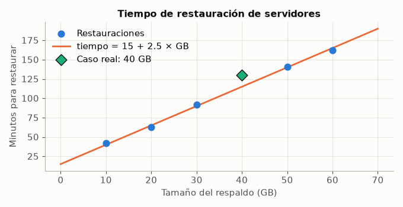

**4. Hipótesis**

> Restaurar un respaldo de 40 GB toma menos de 2 horas según el modelo.

**5. Pregunta**

Completa:

- Intercepto = `____` **[15]** · Pendiente = `____` **[2.5 ± 0.005]**
- Predicción para 40 GB = `____` **[115]** minutos
- Si el caso real tardó 130 minutos, el residuo es `____` **[15]**
- La relación entre GB y minutos es `▾ (positiva / negativa / nula)` **[positiva]**
- La hipótesis `▾ (se cumple / no se cumple)` **[se cumple]**

**Respuesta**

- Ver valores entre corchetes en la pregunta.

**Pista incluida en el contexto (para el docente):** El recuadro define intercepto, pendiente, residuo y recuerda que 2 h = 120 min.

**Explicación:** 15 + 2.5 × 40 = 115 min < 120 → la hipótesis se cumple (según el modelo). Residuo = 130 − 115 = 15 (el modelo subestimó). Pendiente positiva: más GB → más minutos.

---

### Q39. Regresión lineal para clasificar ataques

**Nivel:** Difícil · **Tipo:** Selección única · **Tema:** Regresión lineal vs logística · **Puntaje:** 3

**1. Contexto**

Un practicante quiere estimar la **probabilidad de ataque** según los paquetes por segundo (pps) que recibe un servidor. Ajustó una **regresión lineal** sobre la etiqueta 0/1: `salida = −0.29 + 0.0016 × pps`.

**Recuerda:** una probabilidad **siempre** está entre 0 y 1. La función sigmoide de la regresión logística «aplasta» cualquier valor dentro de ese rango.

**2. Datos de muestra**

| pps | ataque (real) | salida lineal |
|---|---|---|
| 50 | 0 | -0.21 |
| 400 | 0 | 0.35 |
| 900 | 1 | 1.15 |
| 1500 | 1 | 2.11 |

**3. Gráfico**

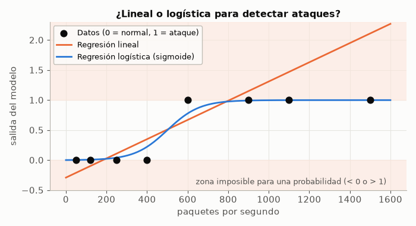

**4. Hipótesis**

> La salida de la regresión lineal puede interpretarse como la probabilidad de ataque.

**5. Pregunta**

¿Qué conclusión es correcta?

**Respuesta**

- ✅ Falsa: la recta produce valores menores que 0 y mayores que 1 (−0.21 y 2.11), imposibles como probabilidad; la regresión logística usa la sigmoide para mantenerse entre 0 y 1.
- ❌ Verdadera: una salida de 2.11 significa que el ataque es «doblemente seguro».
- ❌ Falsa, pero se arregla escalando pps con StandardScaler; así la recta queda entre 0 y 1.
- ❌ Verdadera: basta con redondear la salida al entero más cercano.

**Pista incluida en el contexto (para el docente):** El recuadro fija el rango válido; la tabla y la zona sombreada del gráfico muestran valores fuera de él.

**Explicación:** Con 50 pps la recta da −0.21 y con 1 500 pps da 2.11: no son probabilidades. Escalar no cambia la forma de la recta (sigue siendo ilimitada). La regresión logística aplica la sigmoide y además se ajusta mejor a la forma «escalón» de los datos.

---

### Q40. Elegir modelo por costo, no por exactitud

**Nivel:** Difícil · **Tipo:** Completar · **Tema:** Costo de errores y matriz de confusión · **Puntaje:** según huecos

**1. Contexto**

Un banco evalúa dos detectores de phishing. Seguridad estimó el costo promedio de cada error:

- **Falso negativo** (phishing que llega al empleado): **5 000 Bs** (fraude, recuperación de cuentas).
- **Falso positivo** (correo legítimo bloqueado): **50 Bs** (tiempo de un analista).
**Recuerda:** costo total = FN × 5 000 + FP × 50. En la matriz, FN = abajo-izquierda y FP = arriba-derecha.

**2. Datos de muestra**

| modelo | TN | FP | FN | TP |
|---|---|---|---|---|
| A | 1750 | 40 | 10 | 200 |
| B | 1640 | 150 | 2 | 208 |

**3. Gráfico**

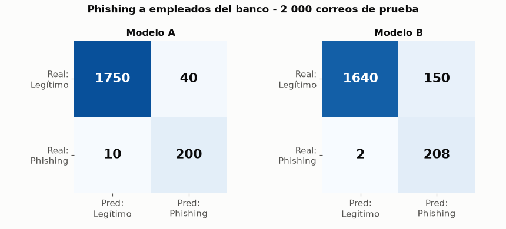

**4. Hipótesis**

> El modelo con mayor exactitud es también el más conveniente para el banco.

**5. Pregunta**

Completa:

- Exactitud A = `____` **[0.975 ± 0.005]** · Exactitud B = `____` **[0.924 ± 0.005]**
- Costo A = `____` **[52000]** Bs · Costo B = `____` **[17500]** Bs
- El modelo más conveniente es `▾ (B / A)` **[B]** y la hipótesis `▾ (no se cumple / se cumple)` **[no se cumple]**
*Escribe los costos sin puntos ni espacios (ej. 12500).*

*Usa punto decimal (ej. 0.75). Se acepta un margen de ±0.005.*

**Respuesta**

- Ver valores entre corchetes en la pregunta.

**Pista incluida en el contexto (para el docente):** El recuadro da la fórmula del costo y dónde está cada error en la matriz.

**Explicación:** Exactitud A = (1750 + 200)/2000 = 0.975; B = (1640 + 208)/2000 = 0.924. Costo A = 10 × 5 000 + 40 × 50 = 52 000 Bs; Costo B = 2 × 5 000 + 150 × 50 = 17 500 Bs. B es menos exacto pero cuesta 3 veces menos: la hipótesis no se cumple.

---

### Q41. Escalar antes de dividir: ¿resultado confiable?

**Nivel:** Difícil · **Tipo:** Selección múltiple (varias correctas) · **Tema:** Fuga de información en el preprocesamiento · **Puntaje:** 3

**1. Contexto**

Un estudiante escribió este código para detectar tráfico malicioso:

```python
scaler = StandardScaler()
X_esc = scaler.fit_transform(X)          # TODO el dataset
X_train, X_test, y_train, y_test = train_test_split(X_esc, y, test_size=0.2)
modelo = KNeighborsClassifier().fit(X_train, y_train)
```
**Recuerda:** `fit` **aprende** algo de los datos (el escalador aprende la media y la desviación). Si aprende de *todo* el dataset, los datos de prueba ya «influyeron» antes de evaluar.

**2. Datos de muestra**

| experimento | exactitud |
|---|---|
| Código original | 0.97 |
| Pipeline (escalador ajustado solo con train) | 0.95 |
| Pipeline evaluado con datos nuevos | 0.94 |

**3. Gráfico**

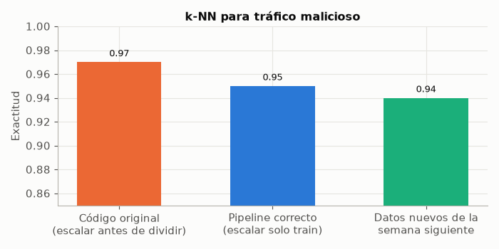

**4. Hipótesis**

> El 0.97 obtenido con el código original es una medida confiable del desempeño real.

**5. Pregunta**

Selecciona **todas** las afirmaciones correctas (las incorrectas restan):

**Respuesta**

- ✅ fit_transform(X) se aplica antes de dividir, así que la media y la desviación incluyen información del conjunto de prueba.
- ✅ Lo correcto es dividir primero y ajustar el escalador solo con X_train (por ejemplo, con un Pipeline).
- ✅ El 0.95 del Pipeline es una estimación más honesta: se parece más al desempeño con datos nuevos (0.94).
- ❌ k-NN no necesita escalado, así que el StandardScaler sobra.
- ❌ Para evitar el problema también hay que escalar y_train.
- ❌ La diferencia 0.97 vs 0.95 demuestra que el Pipeline es un peor modelo.

**Pista incluida en el contexto (para el docente):** El recuadro explica qué aprende fit; el gráfico compara cada experimento con los datos nuevos.

**Explicación:** El código original tiene una fuga leve: el escalador «vio» la prueba. El resultado (0.97) es optimista; el Pipeline (0.95) coincide mejor con los datos nuevos (0.94). k-NN sí necesita escalado y la etiqueta y no se escala en clasificación. La hipótesis es falsa.

---

### Q42. Gaussian Naive Bayes y la transformación logarítmica

**Nivel:** Difícil · **Tipo:** Selección única · **Tema:** Naive Bayes: supuestos y transformaciones · **Puntaje:** 3

**1. Contexto**

Se usa **Gaussian Naive Bayes** para detectar descargas sospechosas. La variable `bytes_descargados` tiene muchísimos valores pequeños y unos pocos enormes. Se probó aplicar `log10`.

**Recuerda:** Gaussian Naive Bayes **supone que cada variable numérica tiene forma de campana (distribución normal)** dentro de cada clase. Si la forma real es muy distinta, sus probabilidades salen mal calculadas.

**2. Datos de muestra**

| descarga | bytes_descargados | log10(bytes) |
|---|---|---|
| D1 | 27 964 | 4.45 |
| D2 | 6 371 | 3.80 |
| D3 | 45 660 | 4.66 |
| D4 | 56 281 | 4.75 |
| D5 | 2 339 | 3.37 |

**3. Gráfico**

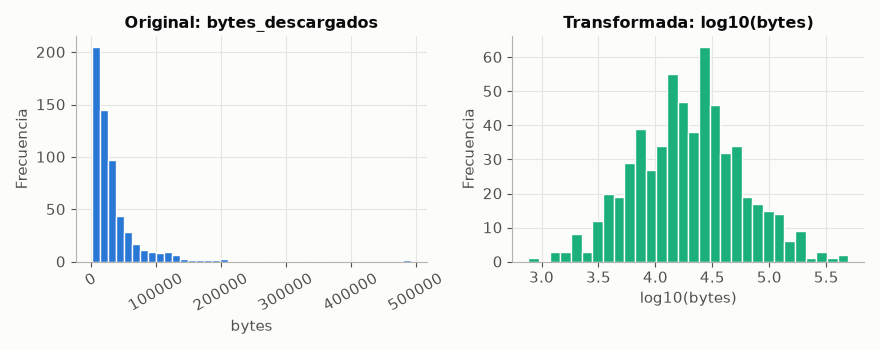

**4. Hipótesis**

> Aplicar logaritmo a `bytes_descargados` puede ayudar a Gaussian Naive Bayes.

**5. Pregunta**

Compara los dos histogramas. ¿Qué conclusión es correcta?

**Respuesta**

- ✅ Verdadera: el logaritmo transforma una distribución muy sesgada en una forma parecida a una campana, que es lo que asume Gaussian Naive Bayes.
- ❌ Falsa: Naive Bayes no supone ninguna forma para las variables numéricas.
- ❌ Verdadera, porque el logaritmo elimina del dataset las filas con valores atípicos.
- ❌ Falsa: las transformaciones logarítmicas solo sirven para la regresión lineal.

**Pista incluida en el contexto (para el docente):** El recuadro dice qué forma asume GaussianNB; el histograma de la derecha muestra esa forma.

**Explicación:** El histograma original tiene cola larga a la derecha; tras `log10` se ve como una campana. Las filas no se eliminan: solo cambia la escala. Así el supuesto gaussiano se cumple mejor.

---

### Q43. Elegir el clasificador según la necesidad del equipo

**Nivel:** Difícil · **Tipo:** Emparejamiento · **Tema:** Comparación de clasificadores · **Puntaje:** 3

**1. Contexto**

Cuatro equipos de TI necesitan un clasificador. En el «torneo» todos obtuvieron exactitud parecida, así que la decisión depende de **otras características** del modelo.

**Recuerda:** piensa en la «personalidad» de cada modelo: el árbol se puede *leer* como reglas; Naive Bayes *cuenta* frecuencias (muy rápido con palabras); la regresión logística da una *probabilidad* con coeficientes interpretables; k-NN *compara* con los casos más parecidos.

**2. Datos de muestra**

| modelo | ¿reglas legibles? | ¿necesita escalado? | ¿da probabilidad? | velocidad con texto |
|---|---|---|---|---|
| Árbol de decisión | sí | no | aprox. | media |
| Naive Bayes | no | no | sí | muy alta |
| Regresión logística | coeficientes | sí | sí | alta |
| k-NN | no | sí | aprox. | baja |

**3. Gráfico**

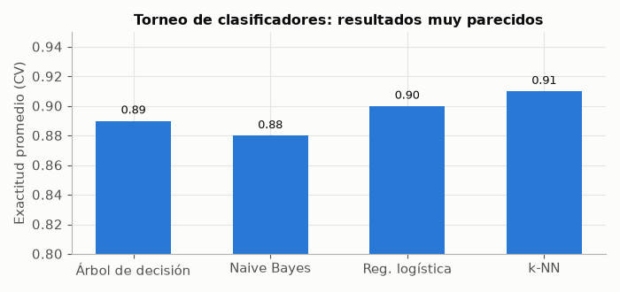

**4. Hipótesis**

> Como los cuatro modelos tienen exactitud parecida, da igual cuál se use en cada equipo.

**5. Pregunta**

Empareja cada necesidad con el modelo más adecuado (sobra una opción):

**Respuesta**

- Auditoría exige reglas «si… entonces…» que una persona pueda leer y justificar. → **Árbol de decisión**
- Clasificar millones de correos por las palabras que contienen, reentrenando cada noche muy rápido. → **Naive Bayes**
- Riesgo necesita una probabilidad de phishing y explicar el peso de cada variable con coeficientes. → **Regresión logística**
- Clasificar un dispositivo nuevo buscando los dispositivos ya conocidos más parecidos. → **k-NN**
- Distractor(es): Regresión lineal

**Pista incluida en el contexto (para el docente):** El recuadro describe la «personalidad» de cada modelo con un verbo: leer, contar, probabilidad, comparar.

**Explicación:** La exactitud no es el único criterio: interpretabilidad, velocidad y tipo de salida también importan. La regresión lineal no es un clasificador. La hipótesis es falsa.

---

### Q44. IDS: ¿qué tan confiable es una alarma?

**Nivel:** Difícil · **Tipo:** Completar · **Tema:** Teorema de Bayes y tasa base · **Puntaje:** según huecos

**1. Contexto**

Un IDS analiza **10 000 conexiones**. Solo el 1 % son ataques. El IDS detecta el 95 % de los ataques, pero también lanza alarma en el 5 % de las conexiones normales.

**Recuerda:** trabaja con **cantidades**, no con porcentajes: primero cuántos ataques y normales hay, luego cuántas alarmas genera cada grupo.  
`P(ataque | alarma) = alarmas de ataques / total de alarmas`.

**2. Datos de muestra**

| grupo | % del tráfico | % que dispara alarma |
|---|---|---|
| Ataques | 1 % | 95 % |
| Normales | 99 % | 5 % |

**3. Gráfico**

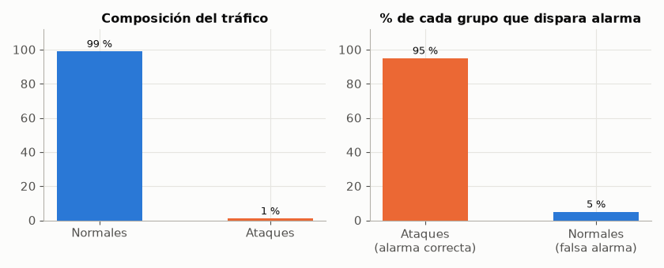

**4. Hipótesis**

> Si el IDS lanza una alarma, hay 95 % de probabilidad de que sea un ataque real.

**5. Pregunta**

Completa:

- Ataques reales = `____` **[100]** · Conexiones normales = `____` **[9900]**
- Alarmas por ataques reales = `____` **[95]** · Falsas alarmas = `____` **[495]**
- Total de alarmas = `____` **[590]**
- P(ataque | alarma) = `____` **[0.161 ± 0.005]**
- La mayoría de las alarmas son `▾ (falsas alarmas / ataques reales)` **[falsas alarmas]** y la hipótesis `▾ (no se cumple / se cumple)` **[no se cumple]**
*Usa punto decimal (ej. 0.75). Se acepta un margen de ±0.005.*

**Respuesta**

- Ver valores entre corchetes en la pregunta.

**Pista incluida en el contexto (para el docente):** El recuadro pide pasar a cantidades: 1 % de 10 000, 95 % de ese grupo, 5 % de los normales.

**Explicación:** 100 ataques → 95 alarmas; 9 900 normales → 495 falsas alarmas; total 590. P(ataque | alarma) = 95/590 ≈ 0.161. Aunque el detector es «95 % bueno», como los ataques son raros, 5 de cada 6 alarmas son falsas. Confundir P(alarma | ataque) con P(ataque | alarma) es un error clásico.

---

### Q45. Curva de aprendizaje: ¿más datos?

**Nivel:** Difícil · **Tipo:** Selección única · **Tema:** Curvas de aprendizaje y subajuste · **Puntaje:** 3

**1. Contexto**

Un filtro de spam usa regresión logística con solo dos variables: `longitud_correo` y `cantidad_mayusculas`. Se entrenó con cantidades crecientes de correos.

**Recuerda:** si las dos curvas **ya se juntaron** y se quedaron **planas en un valor bajo**, el modelo es demasiado simple (subajuste): más datos del mismo tipo casi no ayudan. Si siguen **separadas**, más datos sí suelen ayudar.

**2. Datos de muestra**

| correos | entrenamiento | validación |
|---|---|---|
| 100 | 0.8 | 0.6 |
| 250 | 0.77 | 0.65 |
| 500 | 0.75 | 0.68 |
| 1000 | 0.73 | 0.7 |
| 2000 | 0.72 | 0.71 |
| 3000 | 0.72 | 0.71 |
| 5000 | 0.72 | 0.71 |

**3. Gráfico**

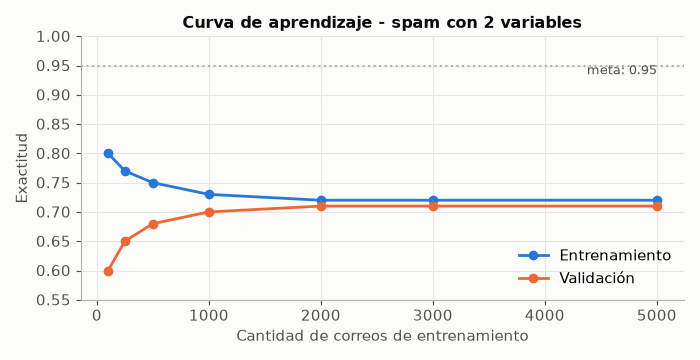

**4. Hipótesis**

> Si conseguimos 50 000 correos más, la exactitud de validación llegará a 0.95.

**5. Pregunta**

¿Qué conclusión es correcta?

**Respuesta**

- ✅ Es poco probable: las curvas convergen en ≈ 0.71 (subajuste); conviene agregar variables más informativas (palabras, enlaces, remitente) o un modelo más flexible.
- ❌ Es muy probable: más datos siempre mejoran cualquier modelo.
- ❌ El modelo sobreajusta; hay que simplificarlo aún más.
- ❌ Hay fuga de información, porque las curvas se juntan.

**Pista incluida en el contexto (para el docente):** El recuadro describe exactamente el patrón del gráfico: curvas juntas y planas en un valor bajo.

**Explicación:** Desde ~2 000 correos ambas curvas quedan en 0.71–0.72: el modelo ya aprendió todo lo que dos variables permiten. El cuello de botella son las variables, no la cantidad de datos.

---

### Q46. Cambiar el umbral y medir el recall

**Nivel:** Difícil · **Tipo:** Arrastrar y soltar · **Tema:** Umbral, predict_proba y métricas · **Puntaje:** 3

**1. Contexto**

El SOC quiere usar un **umbral de 0.3** (en lugar de 0.5) para detectar más ataques, y medir **qué porcentaje de los ataques reales** detecta el modelo.

**Recuerda:** `predict` devuelve 0/1 con umbral 0.5; `predict_proba` devuelve dos columnas: `[:, 0]` = P(normal) y `[:, 1]` = P(ataque). El porcentaje de ataques reales detectados es el **recall**.

**2. Datos de muestra**

| conexión | P(normal) | P(ataque) | real |
|---|---|---|---|
| 1 | 0.82 | 0.18 | 0 |
| 2 | 0.64 | 0.36 | 1 |
| 3 | 0.21 | 0.79 | 1 |
| 4 | 0.55 | 0.45 | 0 |

**3. Gráfico**

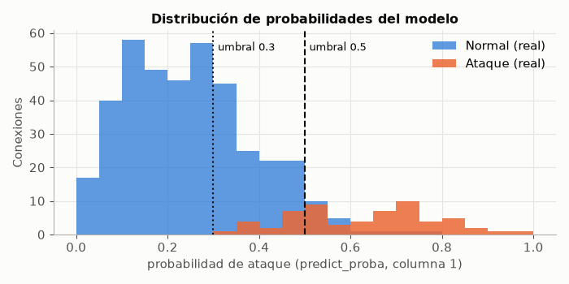

**4. Hipótesis**

> Con umbral 0.3 la conexión 2 (P(ataque) = 0.36) pasa a ser detectada como ataque.

**5. Pregunta**

Arrastra las opciones para completar el código:

```python
probs  = modelo.[[1→predict_proba]](X_test)[:, [[2→1]]]
y_pred = (probs >= [[3→0.3]]).astype(int)
print([[4→recall_score]](y_test, y_pred))
```

**Respuesta**

- [[1]] → **predict_proba** (grupo 1)
- [[2]] → **1** (grupo 2)
- [[3]] → **0.3** (grupo 3)
- [[4]] → **recall_score** (grupo 4)
- Distractores: `predict` (g1), `0` (g2), `0.5` (g3), `precision_score` (g4), `accuracy_score` (g4)

**Pista incluida en el contexto (para el docente):** El recuadro explica las dos columnas de predict_proba y nombra la métrica pedida.

**Explicación:** `predict_proba(X_test)[:, 1]` da P(ataque); `probs >= 0.3` aplica el nuevo umbral; `recall_score` mide los ataques detectados. La hipótesis es verdadera: 0.36 ≥ 0.3.

---

### Q47. Fronteras de decisión de k-NN: k = 1 vs k = 25

**Nivel:** Difícil · **Tipo:** Selección única · **Tema:** k-NN: fronteras de decisión · **Puntaje:** 3

**1. Contexto**

Se entrenó k-NN con dos valores de k para separar flujos de red normales y de ataque. Las zonas coloreadas muestran qué predice el modelo en cada punto del plano.

**Recuerda:** una frontera **muy irregular**, con «islas» alrededor de puntos sueltos, indica que el modelo **memoriza el ruido**. Una frontera suave que sigue la forma general de los grupos suele **generalizar** mejor.

**2. Datos de muestra**

| k | exactitud entrenamiento | exactitud prueba |
|---|---|---|
| 1 | 1.00 | 0.78 |
| 25 | 0.91 | 0.84 |

**3. Gráfico**

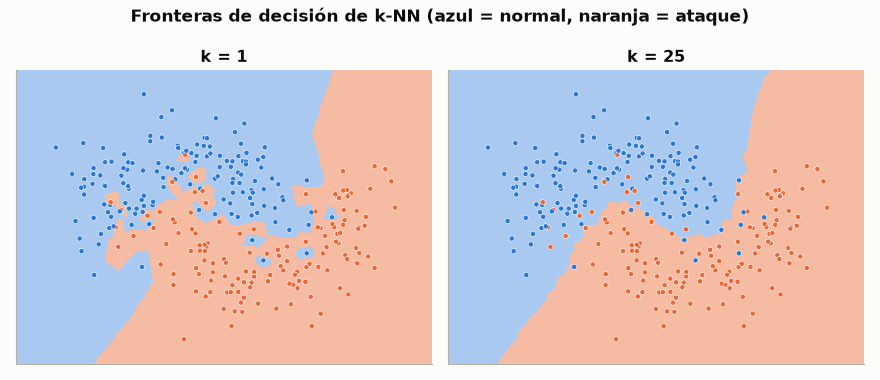

**4. Hipótesis**

> El modelo con k = 1 es el mejor, porque su frontera clasifica correctamente todos los puntos de entrenamiento.

**5. Pregunta**

¿Qué conclusión es correcta?

**Respuesta**

- ✅ Falsa: k = 1 tiene frontera irregular con islas (sobreajuste, 1.00 vs 0.78); k = 25 generaliza mejor (prueba 0.84).
- ❌ Verdadera: 100 % en entrenamiento garantiza el mejor modelo.
- ❌ Falsa: k = 25 sobreajusta porque su frontera es suave.
- ❌ Ambos son equivalentes, porque usan el mismo algoritmo.

**Pista incluida en el contexto (para el docente):** El recuadro relaciona la forma de la frontera con memorizar vs generalizar; la tabla da los números.

**Explicación:** Con k = 1 cada punto «se vota a sí mismo»: entrenamiento 1.00 pero prueba 0.78. Con k = 25 la frontera es suave y la prueba sube a 0.84.

---

### Q48. Una división con suerte vs validación cruzada

**Nivel:** Difícil · **Tipo:** Completar · **Tema:** Validación cruzada · **Puntaje:** según huecos

**1. Contexto**

Un estudiante reportó **recall = 0.95** detectando ataques con una sola división train/test. El docente repitió la evaluación con **validación cruzada de 5 folds**.

**Recuerda:** una sola división puede salir «con suerte» (casos fáciles en prueba). La validación cruzada evalúa varias veces y se reporta el **promedio**; el **rango** (máximo − mínimo) muestra cuánto varía.

**2. Datos de muestra**

| evaluación | recall |
|---|---|
| Fold 1 | 0.8 |
| Fold 2 | 0.85 |
| Fold 3 | 0.9 |
| Fold 4 | 0.75 |
| Fold 5 | 0.7 |
| División única | 0.95 |

**3. Gráfico**

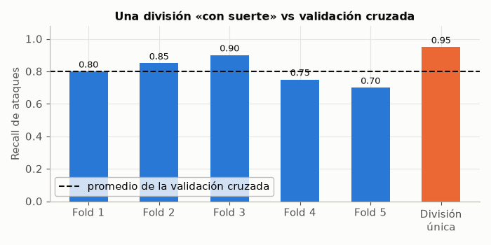

**4. Hipótesis**

> El 0.95 representa el desempeño esperado del modelo con datos nuevos.

**5. Pregunta**

Completa:

- Promedio de la validación cruzada = `____` **[0.80 ± 0.005]**
- Rango (máximo − mínimo) de los folds = `____` **[0.20 ± 0.005]**
- Diferencia entre la división única y el promedio = `____` **[0.15 ± 0.005]**
- El valor más confiable para reportar es `▾ (el promedio de la validación cruzada / el 0.95 de la división única / el mejor fold (0.90))` **[el promedio de la validación cruzada]**
- La hipótesis `▾ (no se cumple / se cumple)` **[no se cumple]**
*Usa punto decimal (ej. 0.75). Se acepta un margen de ±0.005.*

**Respuesta**

- Ver valores entre corchetes en la pregunta.

**Pista incluida en el contexto (para el docente):** El recuadro dice qué se reporta (promedio) y cómo se calcula el rango.

**Explicación:** Promedio = (0.80 + 0.85 + 0.90 + 0.75 + 0.70)/5 = 0.80; rango = 0.90 − 0.70 = 0.20; diferencia = 0.95 − 0.80 = 0.15. El 0.95 es mayor que cualquier fold: fue una división con suerte.

---

### Q49. Árbol único vs Random Forest

**Nivel:** Difícil · **Tipo:** Selección múltiple (varias correctas) · **Tema:** Árboles vs Random Forest · **Puntaje:** 3

**1. Contexto**

Se compararon un árbol de decisión **sin límite de profundidad** y un Random Forest de 200 árboles para detectar URLs maliciosas. Cada modelo se entrenó 5 veces con distintas semillas aleatorias.

**Recuerda:** un Random Forest combina muchos árboles entrenados con muestras distintas; al **promediar votos** reduce el sobreajuste y la **variación** entre ejecuciones.

**2. Datos de muestra**

| ejecución | árbol (prueba) | random forest (prueba) |
|---|---|---|
| 1 | 0.79 | 0.9 |
| 2 | 0.84 | 0.89 |
| 3 | 0.76 | 0.91 |
| 4 | 0.83 | 0.9 |
| 5 | 0.81 | 0.9 |

**3. Gráfico**

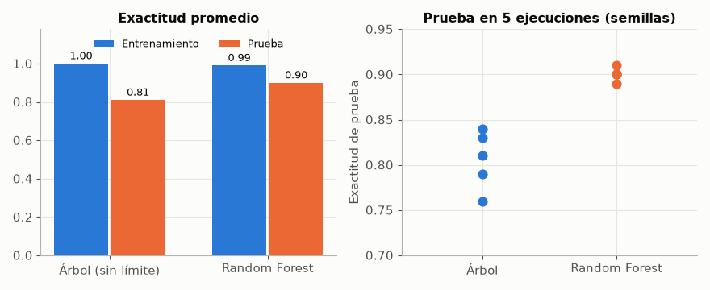

**4. Hipótesis**

> Un Random Forest siempre es peor que un solo árbol porque es más complejo.

**5. Pregunta**

Selecciona **todas** las afirmaciones correctas (las incorrectas restan):

**Respuesta**

- ✅ El árbol sin límite de profundidad muestra sobreajuste (1.00 en entrenamiento vs 0.81 en prueba).
- ✅ El Random Forest generaliza mejor: mayor exactitud de prueba y resultados más estables entre ejecuciones.
- ✅ Limitar max_depth del árbol podría reducir su sobreajuste.
- ❌ Es imposible que un Random Forest sobreajuste, porque promedia muchos árboles.
- ❌ El árbol es mejor porque su exactitud de entrenamiento es 1.00.
- ❌ La diferencia se debe a que el árbol necesita StandardScaler.

**Pista incluida en el contexto (para el docente):** El recuadro anticipa los dos efectos del bosque: menos sobreajuste y menos variación (gráfico derecho).

**Explicación:** Árbol: 1.00 vs 0.81 y resultados entre 0.76 y 0.84. RF: 0.90 estable (0.89–0.91). Un RF puede sobreajustar (aunque menos), y los árboles no necesitan escalado. La hipótesis es falsa.

---

### Q50. Recall 100 % con solo 2 ataques en prueba

**Nivel:** Difícil · **Tipo:** Selección única · **Tema:** División estratificada y clases raras · **Puntaje:** 3

**1. Contexto**

Hay 2 000 registros de inicio de sesión, de los cuales **40 son ataques** (2 %). Se dividió con `train_test_split(X, y, test_size=0.2)` **sin** `stratify`. Por azar, la prueba quedó con solo **2 ataques**, y el modelo detectó ambos.

**Recuerda:** con muy pocos casos, una métrica cambia muchísimo por **un solo** acierto o error. `stratify=y` mantiene la **misma proporción de clases** en entrenamiento y prueba.

**2. Datos de muestra**

| conjunto | filas | ataques | % ataques |
|---|---|---|---|
| Completo | 2000 | 40 | 2.0 % |
| Train (sin stratify) | 1600 | 38 | 2.4 % |
| Test (sin stratify) | 400 | 2 | 0.5 % |
| Test (con stratify) | 400 | 8 | 2.0 % |

**3. Gráfico**

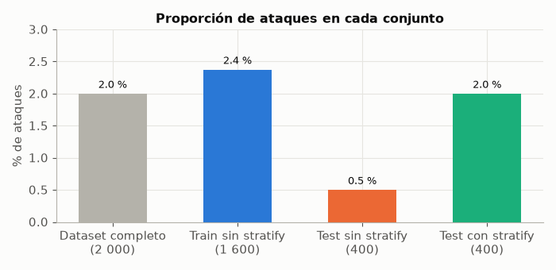

**4. Hipótesis**

> El modelo detecta el 100 % de los ataques (recall = 1.0), así que está listo para producción.

**5. Pregunta**

¿Qué conclusión es correcta?

**Respuesta**

- ✅ Falsa: con solo 2 ataques en prueba el recall de 100 % no es confiable (si fallara uno, sería 50 %); hay que usar stratify=y (≈ 8 ataques en prueba) y, mejor aún, validación cruzada.
- ❌ Verdadera: recall 1.0 significa que el modelo nunca fallará.
- ❌ Falsa: hay que quitar los ataques del entrenamiento para que el modelo no se confunda.
- ❌ Falsa: el problema se resuelve escalando las variables con StandardScaler.

**Pista incluida en el contexto (para el docente):** El recuadro explica el efecto de pocos casos y qué hace stratify; el gráfico muestra 0.5 % vs 2 %.

**Explicación:** 2/2 = 100 %, pero 1/2 sería 50 %: la métrica no es estable con 2 casos. Con `stratify=y` la prueba tendría 2 % de 400 = 8 ataques, igual que el dataset completo.

---
