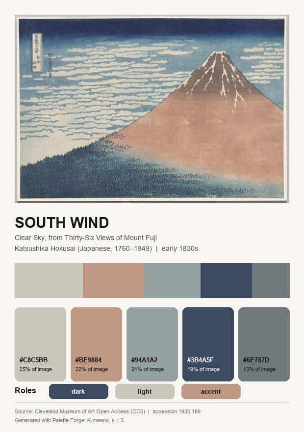
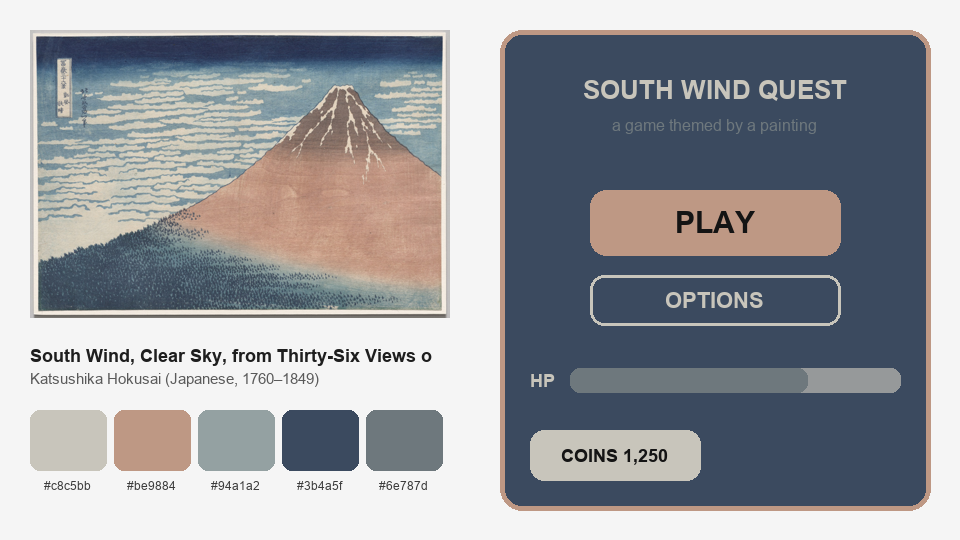

<p align="center"><sub>FROM MODEL TO MEDIUM · ASIGNACIÓN DEL CURSO</sub></p>

<h1 align="center">🎨 Palette Forge Challenge</h1>

<p align="center">
Desarrollo de un servicio que convierte pinturas CC0 de un museo en paletas de color y pantallas temáticas para videojuegos, combinando <em>machine learning</em>, diseño gráfico y una API propia.
</p>

<p align="center">
⏱ <b>Duración:</b> 1 semana &nbsp;·&nbsp; 👤 <b>Individual</b> &nbsp;·&nbsp; 🎯 <b>100 puntos</b> &nbsp;·&nbsp; 📸 <b>Evidencia con capturas de pantalla</b>
</p>

---

## Contenido

1. [Resumen](#1-resumen-de-la-asignación)
2. [Reglas](#2-reglas-de-la-asignación)
3. [Calendario](#3-calendario-sugerido-7-días)
4. [Tareas](#4-tareas-obligatorias--85-puntos)
5. [Opcionales](#5-funcionalidades-opcionales--creative-studio--15-puntos)
6. [Muestras](#6-muestras-de-lo-esperado)
7. [Guías](#7-guías-paso-a-paso)
8. [Rúbrica](#8-rúbrica-de-evaluación-100-puntos)
9. [Evidencias](#9-evidencias-capturas-de-pantalla-requeridas)
10. [Entrega](#10-formato-de-entrega)
11. [Cuestionario](#11-cuestionario-de-revisión-para-el-informe)
12. [Checklist](#12-lista-de-verificación-final)

---

## 1. Resumen de la asignación

*Qué se construye, para qué y qué se espera como resultado.*

**Contexto.** En el diseño de videojuegos y de interfaces, la paleta de color define la identidad visual de un producto. Los museos publican colecciones de arte de dominio público (licencia **CC0**) mediante APIs gratuitas. Esta asignación propone usar esas obras como fuente de inspiración cromática, extrayendo su paleta con *machine learning* y aplicándola a pantallas de juego.

**Objetivo.** El estudiante desarrollará un servicio web (FastAPI) que, a partir de pinturas CC0 del *Cleveland Museum of Art Open Access API*, (1) extrae paletas de color con K-means, (2) entrena dos modelos de ML con dos familias de algoritmos cada uno, (3) genera *posters* de paleta y pantallas temáticas de juego como imágenes PNG y (4) expone todo mediante una API validada, probada y documentada.

> [!NOTE]
> **Flujo general**
>
> Museum API → *dataset* (CSV + imágenes en caché) → K-means → *features* de paleta → 2 modelos de ML → FastAPI → PNG (poster y pantalla temática)

### Competencias que se evalúan

| Técnicas | Creativas y de comunicación |
|---|---|
| REST y manejo de JSON (Topic 1) | Criterio artístico y teoría del color |
| Diseño de API y status codes (Topic 2) | Accesibilidad visual (contraste) |
| FastAPI y TestClient (Topic 3) | Diseño de interfaces de juego |
| Validación con Pydantic (Topic 4) | Documentación y evidencia verificable |
| Serialización de modelos con joblib (Topic 5) | Análisis crítico de resultados |
| Clustering, regresión y clasificación | |

---

## 2. Reglas de la asignación

*El incumplimiento de las reglas obligatorias puede invalidar la entrega o los puntos del criterio afectado.*

### 2.1 Reglas generales

1. La asignación es **individual**. El estudiante deberá entregar código, análisis y redacción propios.
2. El plazo total es de **una semana** a partir de la fecha de publicación. La política de entrega tardía será definida por el docente.
3. El estudiante deberá utilizar **Python 3.10 o superior** y las bibliotecas indicadas en la sección de guías.
4. Los resultados deberán ser **reproducibles**: se fijarán semillas aleatorias (`random_state=42`) y se entregará un archivo `requirements.txt`.
5. Todo resultado afirmado en el informe deberá estar respaldado por una **captura de pantalla** o por una salida visible en un notebook (ver sección [Evidencias](#9-evidencias-capturas-de-pantalla-requeridas)).

### 2.2 Reglas de uso de servicios externos

1. Solo se podrán utilizar servicios **gratuitos y sin clave**. La fuente recomendada es el *Cleveland Museum of Art Open Access API*.
2. Solo se podrán usar obras con licencia **CC0**. El estudiante deberá verificar el campo `share_license_status` en **cada registro**; no se debe confiar únicamente en el filtro de la consulta.
3. Se aplicará el principio de *fair use*: descargar cada imagen una sola vez (caché local), utilizar como máximo **6 hilos** concurrentes y no repetir consultas innecesarias.
4. Está **prohibido** evadir mecanismos de protección contra bots (CAPTCHAs, desafíos de navegador, suplantación de identidad del cliente). Si un servicio bloquea las solicitudes automatizadas, el estudiante deberá cambiar de fuente y documentarlo.
5. No se incluirán claves, contraseñas ni datos personales en el código, el repositorio ni las capturas de pantalla.

### 2.3 Integridad académica y uso de herramientas de IA

1. Se permite consultar documentación, los notebooks del curso y herramientas de asistencia, **siempre que se declare su uso** en el informe (qué herramienta, para qué parte).
2. El estudiante deberá ser capaz de **explicar cualquier línea** de su entrega. El docente podrá solicitar una explicación oral.
3. Toda obra de arte utilizada deberá acreditarse (título, artista, número de accesión, licencia) en el archivo `creditos_obras.csv`.

---

## 3. Calendario sugerido (7 días)

*Dedicación estimada total: 14 a 16 horas. Las tareas se identifican con las letras de la sección 4.*

| Día | Actividad | Horas |
|---|---|---|
| **Día 1** | **Preparación y Tarea A.** Entorno, prueba de la API, recolección de al menos 150 pinturas CC0 y caché de imágenes.<br><sub>Entregable parcial: `artworks.csv` y `creditos_obras.csv`.</sub> | ≈ 2 h |
| **Día 2** | **Tarea B.** Extracción de paletas con K-means y construcción de la tabla de *features*.<br><sub>Entregable parcial: `features.csv`.</sub> | ≈ 2 h |
| **Día 3** | **Tarea C (parte 1).** Exploración, *baseline* y modelos de regresión (año de creación). | ≈ 2.5 h |
| **Día 4** | **Tarea C (parte 2).** Modelos de clasificación (departamento), comparación, guardado con joblib y esquemas Pydantic.<br><sub>Entregable parcial: carpeta `models/`.</sub> | ≈ 2 h |
| **Día 5** | **Tarea D.** API con FastAPI: endpoints, validación, formato único de errores y pruebas automáticas. | ≈ 2.5 h |
| **Día 6** | **Tarea E y opcionales.** Posters, pantallas temáticas, verificación de contraste y funcionalidades de la sección 5. | ≈ 2.5 h |
| **Día 7** | **Tarea F y entrega.** README, informe, capturas de pantalla, cuestionario, revisión con la lista de verificación y empaquetado. | ≈ 2 h |

> [!WARNING]
> **Recomendación de gestión del tiempo**
>
> Si al finalizar el Día 4 los modelos no superan al *baseline*, el estudiante deberá continuar con la API y documentar el análisis del resultado. Un resultado modesto, bien analizado, es válido; omitir una tarea no lo es.

---

## 4. Tareas obligatorias · 85 puntos

*Cada tarea incluye criterios de aceptación. Las casillas pueden marcarse en una copia propia (fork) de este documento para llevar el avance.*

### Tarea A · Recolección de datos `8 pts`

- [ ] Se consulta el *Cleveland Museum of Art Open Access API* con paginación (`limit` y `skip`) y manejo de errores (`timeout`, `raise_for_status`).
- [ ] Se obtienen **al menos 150 pinturas** con licencia CC0 verificada registro por registro e imagen disponible.
- [ ] Se guardan en `artworks.csv` los campos: `id`, `accession_number`, `title`, `artist`, `creation_date_earliest`, `department`, `culture`, `image_url`.
- [ ] Las imágenes se descargan **una sola vez** a una caché local (máx. 6 hilos) y el programa no vuelve a descargarlas si ya existen.
- [ ] Se genera `creditos_obras.csv` con título, artista, número de accesión y licencia de cada obra.

### Tarea B · Paletas y features `12 pts`

- [ ] Para cada imagen se reduce el tamaño (≈80 px de ancho) y se aplica **K-means con k = 5** sobre los píxeles RGB.
- [ ] Los colores se ordenan por proporción (*share*) para obtener un orden consistente entre obras.
- [ ] Se construye `features.csv` con, como mínimo: RGB, HSV y *share* de cada color, más `mean_s`, `mean_v` y `std_v` (saturación y brillo global).
- [ ] Se asignan **roles** a los colores (`dark`, `light`, `accent`) mediante reglas explícitas y justificadas.
- [ ] El informe justifica el valor de k y describe una limitación del método (por ejemplo, que el centro de un grupo es un promedio y atenúa la saturación).

### Tarea C · Dos objetivos, dos familias de modelos cada uno `20 pts`

| Problema | Target | Modelos a comparar | Métricas mínimas |
|---|---|---|---|
| **Regresión** | `creation_date_earliest` (año de creación) | `LinearRegression` (con `StandardScaler`) y `RandomForestRegressor` | R², MAE, comparación con *baseline* (`DummyRegressor`) |
| **Clasificación** | `department` (agrupado: clases con al menos 20 obras; el resto como `Other`) | `LogisticRegression` (con `StandardScaler`) y `RandomForestClassifier` | accuracy, macro-F1, matriz de confusión, comparación con *baseline* (`DummyClassifier`) |

- [ ] La colección contiene obras desde el año −300 hasta 1949. El estudiante deberá **definir y justificar un rango de años** para la regresión (por ejemplo, 1300–1950) y declararlo en el informe.
- [ ] Se usa `train_test_split` (80/20, `random_state=42`; `stratify` en clasificación) y **validación cruzada de 5 folds** para cada modelo.
- [ ] Se reporta una tabla comparativa de los seis modelos (incluidos los dos *baselines*) y al menos un gráfico (real vs. predicho, y matriz de confusión).
- [ ] Se elige un modelo por problema con una regla de decisión explícita y se guarda con `joblib` junto con un archivo `*_meta.json` (nombre, features, métricas, versión de scikit-learn).
- [ ] El informe analiza **por qué** los resultados son modestos o buenos y menciona al menos un caso de error concreto.

> [!WARNING]
> **Expectativa realista**
>
> El color por sí solo es una señal débil para estimar el año o el departamento de una obra. En la corrida de referencia del docente, el mejor modelo de regresión alcanzó un R² de apenas 0.26 y la clasificación llegó a una accuracy cercana a 0.48 frente a 0.24 del *baseline*; un R² cercano a cero es un resultado esperable para el modelo lineal. Se evaluará el rigor del procedimiento y del análisis, no la magnitud de la métrica.

### Tarea D · API con FastAPI `17 pts`

| Endpoint | Función | Respuesta exitosa |
|---|---|---|
| `GET /v1/artworks` | Lista paginada (`page`, `limit` ≤ 50, filtro `department`) | 200, JSON con `items`, `page`, `limit`, `total` |
| `GET /v1/artworks/{id}/palette` | Paleta, roles y metadatos de la obra | 200, JSON |
| `GET /v1/artworks/{id}/palette.png` | Poster de paleta | 200, `image/png` |
| `GET /v1/artworks/{id}/theme.png?screen=title\|hud` | Pantalla temática de juego | 200, `image/png` |
| `POST /v1/predictions` | Recibe una paleta (5 colores hex y sus shares) y devuelve año y departamento predichos | 200, JSON |

- [ ] Los datos de entrada se validan con **Pydantic** (formato hexadecimal, 5 colores, shares entre 0 y 1 que suman ≈ 1, `limit` máximo).
- [ ] Todos los errores usan **un único formato**: `{"error": {"code", "message", "details"}}`, con `404` para recursos inexistentes y `422` para datos inválidos.
- [ ] Los modelos se cargan **una sola vez** al iniciar la aplicación (`lifespan`).
- [ ] Existen al menos **8 pruebas automáticas** (pytest + `TestClient`) que cubren casos exitosos, `404`, `422` y paginación.
- [ ] La documentación automática (`/docs`) muestra todos los endpoints con sus esquemas.

### Tarea E · Producto visual `18 pts`

- [ ] **Poster de paleta** (proporción vertical tipo A4) con: pintura, título, artista, número de accesión, 5 muestras con HEX y porcentaje, y créditos de licencia.
- [ ] **Pantallas temáticas** (`title` y `hud`) construidas solo con los colores de la paleta: fondo, botón principal, texto, barra de vida u otro elemento de interfaz.
- [ ] Se generan posters y pantallas para **al menos 3 obras** de estilos claramente distintos.
- [ ] Todo texto cumple una **relación de contraste ≥ 4.5:1** (WCAG) respecto a su fondo; el cálculo se implementa y se muestra en el informe.
- [ ] El informe incluye una breve **justificación de dirección de arte** (1 párrafo por obra): por qué la paleta resultante transmite el ambiente elegido para el juego.

### Tarea F · Documentación y evidencia `10 pts`

- [ ] `README.md` con descripción, versión de Python, instalación, orden de ejecución y comando para iniciar la API.
- [ ] Informe de 1 a 2 páginas (PDF o Markdown) que responde el [cuestionario de revisión](#11-cuestionario-de-revisión-para-el-informe) y declara el uso de herramientas de IA.
- [ ] Carpeta `evidencias/` con las capturas de pantalla S01 a S12 (ver sección 9), nombradas y referenciadas en el informe.
- [ ] Bitácora de tiempo por día (horas dedicadas y principales dificultades).

---

## 5. Funcionalidades opcionales · Creative Studio · 15 puntos

*Esta sección vale 15 de los 100 puntos. El estudiante seleccionará **hasta tres** funcionalidades (5 puntos cada una) o propondrá una propia. Se valora la creatividad, la coherencia visual y la conexión con los contenidos del curso.*

> [!TIP]
> **Criterios de puntaje por funcionalidad (5 pts)**
>
> Funciona y está integrada al proyecto (2) · Evidencia con captura de pantalla (1) · Justificación artística o técnica de las decisiones de diseño (2).

| # | Funcionalidad | Descripción |
|---|---|---|
| 1 | **Colores vívidos** | Reemplazar el promedio del cluster por el píxel real más saturado de cada grupo y comparar visualmente ambas paletas. |
| 2 | **Armonía cromática** | Clasificar la paleta como complementaria, análoga o triádica con matemática HSV y mostrar la rueda de color. |
| 3 | **Accesibilidad** | Informe de contraste de todos los pares de colores y simulación de daltonismo (protanopia, deuteranopia) de la pantalla temática. |
| 4 | **Búsqueda por ambiente** | Dado un color o una paleta, recuperar las obras más parecidas (vecinos más cercanos en espacio de color) con un endpoint nuevo. |
| 5 | **Mezcla de dos pinturas** | Combinar las paletas de dos obras en un tema híbrido y generar la pantalla resultante. |
| 6 | **Kit de assets de juego** | A partir de la paleta, generar un marco de carta, un logo tipográfico, una pantalla de carga o un *tileset* de 4×4 tiles. |
| 7 | **Mapa de la colección** | Proyectar las paletas de todas las obras con PCA y graficar el mapa coloreado por departamento o época. |
| 8 | **Interfaz con Streamlit** | Página con selector de obra o de color que consume la API y muestra el poster y la pantalla temática. |
| 9 | **Programa consumidor** | Un segundo programa independiente que solo conoce URLs y JSON y descarga posters de varias obras. |
| 10 | **Poster de impresión** | Diseño tipográfico cuidado con jerarquía visual, exportado a PNG de alta resolución o PDF. |
| 11 | **Despliegue y seguridad** | Dockerfile funcional, API key en un header y caché de respuestas de imágenes. |
| 12 | **Propuesta propia** | Idea original que combine arte, diseño y los contenidos del curso. Requiere aprobación previa del docente (máximo el Día 3). |

> [!NOTE]
> **Mentalidad abierta**
>
> No existe una única solución correcta. Se valoran decisiones argumentadas: por qué esa paleta, por qué esa tipografía, qué emoción busca transmitir la pantalla y cómo se comprobó que es legible.

---

## 6. Muestras de lo esperado

*Ejemplos de referencia. Los valores numéricos son ilustrativos: el estudiante obtendrá resultados distintos con sus propios datos.*

### 6.1 Poster de paleta (Tarea E)

<table>
<tr>
<td width="50%">

<br><sub>Poster de ejemplo: <em>South Wind, Clear Sky</em> (Hokusai, Cleveland Museum of Art, CC0).</sub>
</td>
<td width="50%" valign="top">

Elementos mínimos observables:

- Pintura completa en la parte superior.
- Título, artista, época y número de accesión.
- Franja con la proporción de cada color.
- Cinco muestras con HEX y porcentaje.
- Roles (`dark`, `light`, `accent`).
- Línea de créditos con fuente y licencia.

</td>
</tr>
</table>

### 6.2 Pantalla temática (Tarea E)



<sub>Izquierda: obra y paleta. Derecha: pantalla de juego que usa únicamente esos cinco colores (fondo, botón, texto, barra de vida).</sub>

### 6.3 Respuestas JSON (Tarea D)

**`GET /v1/artworks/111654/palette` → 200**

```json
{
  "id": 111654,
  "accession_number": "1930.189",
  "title": "South Wind, Clear Sky, from Thirty-Six Views of Mount Fuji",
  "artist": "Katsushika Hokusai (Japanese, 1760-1849)",
  "license": "CC0",
  "palette": [
    {"hex": "#C8C5BB", "rgb": [200, 197, 187], "share": 0.25},
    {"hex": "#BE9884", "rgb": [190, 152, 132], "share": 0.22},
    {"hex": "#94A1A2", "rgb": [148, 161, 162], "share": 0.21},
    {"hex": "#3B4A5F", "rgb": [59, 74, 95], "share": 0.19},
    {"hex": "#6E787D", "rgb": [110, 120, 125], "share": 0.13}
  ],
  "roles": {"dark": "#3B4A5F", "light": "#C8C5BB", "accent": "#BE9884"}
}
```

**`POST /v1/predictions` → 200** <sub>(valores ilustrativos)</sub>

```text
# request
{
  "colors": ["#C8C5BB", "#BE9884", "#94A1A2", "#3B4A5F", "#6E787D"],
  "shares": [0.25, 0.22, 0.21, 0.19, 0.13]
}

# response
{
  "predicted_year": 1810.4,
  "predicted_department": "Japanese Art",
  "department_probabilities": {
    "Japanese Art": 0.46,
    "European Painting and Sculpture": 0.31,
    "Other": 0.23
  },
  "model_version": "LinearRegression + RandomForest"
}
```

### 6.4 Errores con formato único (Tarea D)

**`GET /v1/artworks/999999999/palette` → 404**

```json
{
  "error": {
    "code": "ARTWORK_NOT_FOUND",
    "message": "Artwork 999999999 does not exist",
    "details": null
  }
}
```

**`POST /v1/predictions` con un color inválido → 422**

```json
{
  "error": {
    "code": "INVALID_INPUT",
    "message": "The request data is not valid",
    "details": [
      {"field": "colors.2", "message": "Color must match #RRGGBB"}
    ]
  }
}
```

### 6.5 Tabla comparativa de modelos (Tarea C)

Formato esperado. Los valores provienen de una corrida de referencia del docente con 593 pinturas; los del estudiante diferirán.

| Problema | Modelo | Métrica principal | Métrica secundaria |
|---|---|---|---|
| Regresión (año) | DummyRegressor (baseline) | R² = -0.0 | MAE = 162.2 años |
| Regresión (año) | LinearRegression | R² = 0.06 | MAE = 148.0 años |
| Regresión (año) | RandomForestRegressor | R² = 0.263 | MAE = 132.6 años |
| Clasificación (departamento) | DummyClassifier (baseline) | accuracy = 0.242 | macro-F1 = 0.049 |
| Clasificación (departamento) | LogisticRegression | accuracy = 0.408 | macro-F1 = 0.392 |
| Clasificación (departamento) | RandomForestClassifier | accuracy = 0.475 | macro-F1 = 0.395 |

> [!WARNING]
> **Qué debe agregar el estudiante**
>
> La corrida de referencia usa una sola partición 80/20. La entrega del estudiante deberá incluir además la **media y la desviación estándar de la validación cruzada de 5 folds** para cada modelo (una columna adicional en la tabla). Con pocos datos, una sola partición puede ser engañosa.

### 6.6 Estructura de carpetas de la entrega

```text
apellido_nombre_PaletteForge/
├── README.md
├── requirements.txt
├── informe.pdf                 (o informe.md)
├── creditos_obras.csv
├── notebooks/
│   ├── 01_recoleccion.ipynb
│   ├── 02_paletas.ipynb
│   └── 03_modelos.ipynb
├── app/
│   ├── main.py   schemas.py   palette.py   models_service.py   render.py
├── tests/
│   └── test_api.py
├── data/            artworks.csv   features.csv      (sin la caché de imágenes)
├── models/          *.joblib   *_meta.json
├── outputs/         posters/   themes/   opcionales/
└── evidencias/      S01_docs.png ... S12_*.png  (+ SO1..SO3)
```

### 6.7 Salida esperada de las pruebas (Tarea D)

```text
$ python -m pytest -v
tests/test_api.py::test_list_artworks_ok               PASSED
tests/test_api.py::test_list_pagination_envelope       PASSED
tests/test_api.py::test_palette_json_ok                PASSED
tests/test_api.py::test_palette_png_is_image           PASSED
tests/test_api.py::test_theme_png_is_image             PASSED
tests/test_api.py::test_unknown_artwork_404_standard   PASSED
tests/test_api.py::test_prediction_ok                  PASSED
tests/test_api.py::test_prediction_invalid_color_422   PASSED
================ 8 passed in 3.41s ================
```

---

## 7. Guías paso a paso

*Orientaciones y código de partida. Los identificadores se mantienen en inglés; los comentarios, en español. El código de partida debe ser comprendido, adaptado y ampliado por el estudiante.*

<details open>
<summary><b>Preparación del entorno</b></summary>

Se recomienda crear un entorno virtual y ejecutar el trabajo en notebooks para las etapas A a C, y en archivos `.py` para la API.

```bash
python -m venv venv
venv\Scripts\activate          # Windows
pip install requests pandas numpy scikit-learn matplotlib pillow joblib fastapi uvicorn httpx pydantic pytest
```

> [!WARNING]
> **Red corporativa o error SSL**
>
> Si aparece `SSLCertVerificationError`, se instala `pip install truststore` y se agregan al inicio del notebook las líneas `import truststore; truststore.inject_into_ssl()`. No se debe desactivar la verificación de certificados.

> [!CAUTION]
> **Fuentes que bloquean scripts**
>
> El API del Art Institute of Chicago y el servidor de imágenes del Metropolitan Museum devuelven una página de verificación anti-bots a las solicitudes automatizadas. Según la regla 2.2.4, no se debe intentar evadirla: se utiliza el Cleveland Museum of Art.

</details>

<details>
<summary><b>Tarea A · Recolección: consulta paginada, verificación de licencia y caché</b></summary>

La consulta usa los parámetros `type=Painting`, `has_image=1` y `cc0=1`. La paginación se controla con `limit` y `skip`. El filtro no sustituye la verificación del campo `share_license_status`.

```python
import requests, pandas as pd

CMA = "https://openaccess-api.clevelandart.org/api/artworks/"
FIELDS = ("id,accession_number,title,creation_date_earliest,creators,department,"
          "culture,share_license_status,images")

rows = []
for skip in range(0, 300, 100):                       # 3 páginas de 100
    r = requests.get(CMA, params={"type": "Painting", "has_image": 1, "cc0": 1,
                                  "limit": 100, "skip": skip, "fields": FIELDS}, timeout=60)
    r.raise_for_status()
    for a in r.json()["data"]:
        web = (a.get("images") or {}).get("web") or {}
        if a.get("share_license_status") == "CC0" and web.get("url"):   # verificación por registro
            rows.append({"id": a["id"], "accession_number": a["accession_number"],
                         "title": a["title"], "year": a.get("creation_date_earliest"),
                         "artist": (a.get("creators") or [{}])[0].get("description", ""),
                         "department": a.get("department"), "image_url": web["url"]})

artworks = pd.DataFrame(rows).drop_duplicates("id")
print(len(artworks), "obras CC0")
```

Para la caché de imágenes se descarga con un `ThreadPoolExecutor(max_workers=6)` y se guarda cada archivo como `cache/{id}.jpg`; si el archivo existe, no se vuelve a pedir.

</details>

<details>
<summary><b>Tarea B · K-means y construcción de features</b></summary>

Cada píxel es un punto de tres dimensiones (R, G, B). K-means agrupa píxeles similares y los centros de los grupos forman la paleta. Ordenar por tamaño de grupo garantiza que el color 0 sea siempre el dominante.

```python
import numpy as np, colorsys
from PIL import Image
from sklearn.cluster import KMeans

def extract_palette(img, k=5):
    small = img.resize((80, max(1, int(80 * img.height / img.width))))
    px = np.asarray(small.convert("RGB")).reshape(-1, 3)
    km = KMeans(n_clusters=k, n_init=10, random_state=42).fit(px)
    share = np.bincount(km.labels_, minlength=k) / len(px)
    order = np.argsort(-share)                         # color dominante primero
    return km.cluster_centers_[order], share[order]

def palette_features(colors, shares):
    f = {}
    for i, (c, s) in enumerate(zip(colors, shares)):
        h, sat, v = colorsys.rgb_to_hsv(*(c / 255))
        f.update({f"c{i}_r": c[0], f"c{i}_g": c[1], f"c{i}_b": c[2],
                  f"c{i}_h": h, f"c{i}_s": sat, f"c{i}_v": v, f"c{i}_share": s})
    return f
```

> [!WARNING]
> **Tiempo de cómputo**
>
> En la prueba del docente, extraer la paleta de 600 imágenes con 6 hilos tomó unos 8 minutos (≈ 0.8 s por imagen, incluida la descarga). Se recomienda guardar el resultado en `features.csv` y no recalcularlo en cada ejecución del notebook.

Los roles se asignan con reglas: `dark` = menor luminancia, `light` = mayor luminancia, `accent` = mayor saturación entre los restantes. Cualquier regla es válida si se justifica.

</details>

<details>
<summary><b>Tarea C · Modelos, validación cruzada y guardado</b></summary>

```python
from sklearn.model_selection import train_test_split, cross_val_score
from sklearn.pipeline import make_pipeline
from sklearn.preprocessing import StandardScaler
from sklearn.dummy import DummyRegressor
from sklearn.linear_model import LinearRegression
from sklearn.ensemble import RandomForestRegressor
from sklearn.metrics import r2_score, mean_absolute_error
import joblib

# X = features.csv (sin identificadores); y = año de creación (descartar nulos).
# La colección incluye obras desde el año -300: definir y justificar un rango, por ejemplo 1300-1950.
X_train, X_test, y_train, y_test = train_test_split(X, y, test_size=0.2, random_state=42)

models = {
    "baseline": DummyRegressor(),
    "linear": make_pipeline(StandardScaler(), LinearRegression()),
    "forest": RandomForestRegressor(n_estimators=300, random_state=42, n_jobs=-1),
}
for name, m in models.items():
    m.fit(X_train, y_train)
    p = m.predict(X_test)
    cv = cross_val_score(m, X, y, cv=5, scoring="r2").mean()
    print(f"{name:<9} R2={r2_score(y_test, p):.3f}  MAE={mean_absolute_error(y_test, p):.1f}  CV R2={cv:.3f}")

joblib.dump(models["linear"], "models/year_regressor.joblib")
```

Para la clasificación se procede igual con `DummyClassifier`, `LogisticRegression(class_weight="balanced")` y `RandomForestClassifier(class_weight="balanced_subsample")`, con `stratify=y` y métricas `accuracy` y `f1_score(average="macro")`. El agrupamiento de clases se realiza antes de dividir los datos:

```python
counts = artworks["department"].value_counts()
keep = counts[counts >= 20].index
artworks["group"] = artworks["department"].where(artworks["department"].isin(keep), "Other")
```

> [!NOTE]
> **Regla de decisión sugerida**
>
> Elegir el modelo con mejor resultado en validación cruzada; si la diferencia con el modelo lineal es menor al 5 %, preferir el más simple. Cualquier regla es aceptable si se declara antes de ver los resultados de prueba.

</details>

<details>
<summary><b>Tarea D · Esquemas Pydantic, formato de errores y esqueleto de la API</b></summary>

```python
# schemas.py
from typing import List
from pydantic import BaseModel, Field, field_validator
import re

class PaletteInput(BaseModel):
    colors: List[str] = Field(min_length=5, max_length=5)
    shares: List[float] = Field(min_length=5, max_length=5)

    @field_validator("colors")
    @classmethod
    def valid_hex(cls, v):
        for c in v:
            if not re.fullmatch(r"#[0-9A-Fa-f]{6}", c):
                raise ValueError("Color must match #RRGGBB")
        return v

    @field_validator("shares")
    @classmethod
    def valid_shares(cls, v):
        if any(s < 0 or s > 1 for s in v) or abs(sum(v) - 1) > 0.05:
            raise ValueError("Shares must be between 0 and 1 and sum to about 1")
        return v
```

```python
# main.py (esqueleto)
from contextlib import asynccontextmanager
from fastapi import FastAPI, Query, Response
from fastapi.exceptions import RequestValidationError
from fastapi.responses import JSONResponse

state = {}

@asynccontextmanager
async def lifespan(app):
    state["regressor"] = ...     # joblib.load(...) una sola vez
    state["classifier"] = ...
    state["artworks"] = ...      # pandas.read_csv(...)
    yield

app = FastAPI(title="Palette Forge API", version="1.0.0", lifespan=lifespan)

class ApiError(Exception):
    def __init__(self, status, code, message):
        self.status, self.code, self.message = status, code, message

def error_body(code, message, details=None):
    return {"error": {"code": code, "message": message, "details": details}}

@app.exception_handler(ApiError)
async def api_error_handler(request, exc):
    return JSONResponse(status_code=exc.status, content=error_body(exc.code, exc.message))

@app.exception_handler(RequestValidationError)
async def validation_handler(request, exc):
    details = [{"field": ".".join(str(p) for p in e["loc"][1:]), "message": e["msg"]} for e in exc.errors()]
    return JSONResponse(status_code=422, content=error_body("INVALID_INPUT", "The request data is not valid", details))

@app.get("/v1/artworks/{artwork_id}/palette.png")
def palette_png(artwork_id: int):
    ...                                     # buscar obra (404 si no existe), dibujar poster con Pillow
    return Response(content=png_bytes, media_type="image/png")
```

Las rutas de imagen devuelven `Response(content=bytes, media_type="image/png")`, no JSON. Las pruebas utilizan `with TestClient(app) as client:` para ejecutar el `lifespan`.

```bash
python -m uvicorn app.main:app --reload --port 8000     # abrir http://127.0.0.1:8000/docs
python -m pytest -v
```

</details>

<details>
<summary><b>Tarea E · Dibujo con Pillow y verificación de contraste (WCAG)</b></summary>

La relación de contraste entre dos colores se calcula con la luminancia relativa definida por WCAG 2.1. El estándar exige al menos 4.5:1 para texto normal.

```python
def relative_luminance(rgb):
    def lin(v):
        v /= 255
        return v / 12.92 if v <= 0.03928 else ((v + 0.055) / 1.055) ** 2.4
    r, g, b = (lin(v) for v in rgb)
    return 0.2126 * r + 0.7152 * g + 0.0722 * b

def contrast_ratio(a, b):
    la, lb = sorted((relative_luminance(a), relative_luminance(b)), reverse=True)
    return (la + 0.05) / (lb + 0.05)

def readable_text_color(bg):
    """Elige negro o blanco, el que tenga mayor contraste con el fondo."""
    black, white = (20, 20, 20), (250, 250, 250)
    return black if contrast_ratio(bg, black) >= contrast_ratio(bg, white) else white

assert contrast_ratio((0, 0, 0), (255, 255, 255)) > 20      # prueba de sanidad
```

```python
from PIL import Image, ImageDraw, ImageFont
from io import BytesIO

def get_font(size, bold=False):
    for name in (["arialbd.ttf", "DejaVuSans-Bold.ttf"] if bold else ["arial.ttf", "DejaVuSans.ttf"]):
        try:
            return ImageFont.truetype(name, size)
        except OSError:
            continue
    return ImageFont.load_default(size)

def to_png_bytes(img):
    buffer = BytesIO()
    img.save(buffer, format="PNG")
    return buffer.getvalue()
```

Si el contraste de un par texto/fondo es menor a 4.5, el diseño debe corregirse (cambiar el color del texto, oscurecer el fondo o agregar una banda de apoyo) y esa decisión se documenta.

</details>

<details>
<summary><b>Tarea F · Cómo documentar y capturar la evidencia</b></summary>

- El README se redacta como si otra persona fuese a ejecutar el proyecto desde cero, siguiendo solo ese archivo.
- Cada captura de pantalla se nombra según la tabla de la sección 9 y se referencia en el informe con una frase que indica qué demuestra.
- Antes de entregar, se ejecuta el proyecto desde una carpeta limpia para verificar que las instrucciones funcionan.

</details>

### Problemas frecuentes

| Síntoma | Causa probable | Acción |
|---|---|---|
| `403` o una página HTML en lugar de la imagen | Protección anti-bots del servidor | Cambiar de fuente; no evadir la protección |
| `ModuleNotFoundError` | Kernel o entorno incorrecto | Seleccionar el kernel del entorno virtual y reiniciar |
| Los modelos no cargan en la API | Distinta versión de scikit-learn | Registrar la versión en `*_meta.json` y usar la misma al servir |
| `Address already in use` | Otro servidor ocupa el puerto | Detenerlo o usar `--port 8001` |
| Texto ilegible en la pantalla temática | Contraste insuficiente | Aplicar `readable_text_color` y verificar ≥ 4.5 |
| R² negativo en regresión | El modelo es peor que predecir la media | Es un resultado válido; analizarlo en el informe |

---

## 8. Rúbrica de evaluación (100 puntos)

*Un criterio sin evidencia verificable (captura de pantalla o salida visible) no podrá recibir el puntaje completo.*

| Criterio | Pts | Excelente | Satisfactorio | Insuficiente |
|---|:---:|---|---|---|
| **A · Recolección** | 8 | ≥ 150 obras CC0 verificadas por registro, caché, créditos completos | Cumple la cantidad pero con créditos o caché incompletos | Menos obras, licencia sin verificar o descargas repetidas |
| **B · Paletas y features** | 12 | K-means correcto, features completos, roles justificados, limitación analizada | Funciona, con justificación parcial | Orden inconsistente de colores o features faltantes |
| **C · Modelos** | 20 | 6 modelos con baseline y CV, tabla y gráficos, regla de decisión, análisis crítico con casos de error | Comparación correcta, análisis superficial | Sin baseline, sin CV o sin separar datos de prueba |
| **D · API** | 17 | 5 endpoints, Pydantic, error único, lifespan, ≥ 8 pruebas que pasan, /docs completo | Endpoints funcionales con validación o pruebas parciales | Endpoints que fallan o errores sin formato común |
| **E · Producto visual** | 18 | Posters y pantallas para ≥ 3 obras distintas, contraste ≥ 4.5 comprobado, justificación de arte | Productos correctos con contraste o justificación parcial | Colores ajenos a la paleta o texto ilegible |
| **F · Documentación y evidencia** | 10 | README reproducible, informe completo, S01–S12 claras, bitácora | Falta algún elemento menor | Faltan capturas o el README no permite ejecutar |
| **Creative Studio** | 15 | 3 funcionalidades (5 pts c/u) integradas, documentadas y justificadas | 1 o 2 funcionalidades completas | Funcionalidades sin evidencia o sin justificación |
| **Total** | **100** | | | |

---

## 9. Evidencias: capturas de pantalla requeridas

*Las capturas permiten verificar el trabajo sin ejecutar el código. Se solicitan los siguientes archivos dentro de `evidencias/`.*

> [!IMPORTANT]
> **Reglas para toda captura de pantalla**
>
> Ancho mínimo de 1280 px y texto legible · debe verse la URL del navegador o el comando ejecutado · debe verse el *status code* o el resultado · sin claves, correos ni datos personales · formato PNG · nombre exacto según la tabla.

| Archivo | Qué debe mostrar | Tarea |
|---|---|:---:|
| `S01_docs.png` | Página `/docs` con los 5 endpoints visibles | D |
| `S02_list.png` | `GET /v1/artworks` ejecutado en `/docs` con `limit` y respuesta 200 | D |
| `S03_palette_json.png` | Respuesta JSON de `/palette` de una obra | B, D |
| `S04_poster.png` | Poster de paleta abierto en el navegador (URL `palette.png` visible) | E |
| `S05_theme.png` | Pantallas `title` y `hud` de una obra (URLs visibles) | E |
| `S06_prediction_ok.png` | `POST /v1/predictions`: cuerpo enviado y respuesta 200 | C, D |
| `S07_error_404.png` | Respuesta 404 con el formato único de error | D |
| `S08_error_422.png` | Respuesta 422 con `details` que identifica el campo inválido | D |
| `S09_tests.png` | Terminal con `pytest -v` y todas las pruebas aprobadas | D |
| `S10_model_table.png` | Tabla comparativa de los 6 modelos (incluye baselines y CV) | C |
| `S11_model_plots.png` | Gráfico real vs. predicho y matriz de confusión | C |
| `S12_gallery.png` | Montaje de posters y pantallas de al menos 3 obras distintas, con la verificación de contraste (≥ 4.5) visible | E |
| `SO1`, `SO2`, `SO3` | Una captura por cada funcionalidad opcional elegida, con un nombre descriptivo (por ejemplo `SO1_colorblind.png`) | Opcional |

---

## 10. Formato de entrega

1. Se comprimirá la carpeta del proyecto en un único archivo `apellido_nombre_PaletteForge.zip` con la estructura de la sección 6.6.
2. **Se incluirá:** código, notebooks con las salidas visibles, `requirements.txt`, `README.md`, informe, `creditos_obras.csv`, `data/`, `models/`, `outputs/` y `evidencias/`.
3. **Se excluirá:** la caché de imágenes descargadas, el entorno virtual (`venv/`), archivos `__pycache__`, claves o credenciales.
4. El canal y la fecha límite de entrega serán indicados por el docente.
5. El informe incluirá la declaración: *“Declaro que este trabajo es original, que las obras utilizadas tienen licencia CC0 y que el uso de herramientas de apoyo está indicado en el informe.”*

---

## 11. Cuestionario de revisión (para el informe)

*Respuestas breves (3 a 5 líneas cada una), redactadas por el estudiante.*

1. ¿Por qué se eligió el valor de `k` y qué ocurre si se cambia a 3 o a 8?
2. ¿Por qué el centro de un cluster de K-means suele ser menos vívido que los colores reales de la obra?
3. ¿Qué modelo se seleccionó para cada problema y con qué regla de decisión?
4. ¿Superaron los modelos al *baseline*? Explicar con las métricas y proponer una causa del resultado.
5. Describir un caso concreto en que el modelo se equivoca y por qué podría ocurrir.
6. ¿Por qué la accuracy puede ser engañosa en el problema de clasificación y qué métrica la complementa?
7. ¿Cómo se verificó la licencia de cada obra y qué medidas de *fair use* se aplicaron?
8. ¿Por qué los modelos se cargan una sola vez al iniciar la API y qué pasaría si se cargaran en cada *request*?
9. Justificar una decisión de diseño visual (paleta, tipografía, jerarquía) y cómo se comprobó su legibilidad.
10. ¿Qué cambiaría el estudiante si dispusiera de diez veces más datos o de más tiempo?
11. Declarar el uso de herramientas de IA o de otras ayudas (cuál, para qué parte) y la dedicación en horas por día.

---

## 12. Lista de verificación final

*Se recomienda completarla antes de comprimir la entrega.*

**Código y datos**

- [ ] Funciona desde una carpeta limpia siguiendo solo el README
- [ ] `requirements.txt` actualizado
- [ ] Semillas fijas (`random_state=42`)
- [ ] Licencia CC0 verificada por registro
- [ ] Sin claves ni datos personales
- [ ] Las pruebas pasan (≥ 8)

**Resultados y evidencia**

- [ ] Tabla comparativa con 6 modelos
- [ ] Contraste ≥ 4.5 comprobado
- [ ] Capturas S01 a S12 con nombre correcto
- [ ] Capturas de las opcionales (SO1 a SO3)
- [ ] `creditos_obras.csv` completo

**Informe**

- [ ] Cuestionario respondido (11 preguntas)
- [ ] Justificación de dirección de arte por obra
- [ ] Declaración de originalidad y de uso de IA
- [ ] Bitácora de horas por día

**Empaquetado**

- [ ] Nombre `apellido_nombre_PaletteForge.zip`
- [ ] Sin caché de imágenes ni `venv/`
- [ ] Estructura de carpetas según la sección 6.6

---

**Referencias.**
[Cleveland Museum of Art Open Access API](https://openaccess-api.clevelandart.org/) ·
[FastAPI](https://fastapi.tiangolo.com/) ·
[scikit-learn](https://scikit-learn.org/stable/) ·
[Pydantic](https://docs.pydantic.dev/) ·
[Pillow](https://pillow.readthedocs.io/) ·
[WCAG 2.1: contraste mínimo](https://www.w3.org/TR/WCAG21/#contrast-minimum)

<sub>Documento de la serie <em>From Model to Medium</em>. Los términos técnicos se mantienen en inglés para facilitar la consulta de la documentación oficial.</sub>
